# Who decided what? Human and AI decisions in Lead Rush II

Lead Rush II is a first-person shooter built in Unity HDRP in five days, November 16 to 20, 2026. One developer directed four AI coding
agents through prompts and play-testing. The agents were Claude Code (`claude-opus-5-5`), Antigravity "Gemini" (`argon` and
`gemini-4-hydrogen` variants), GitHub Copilot (`gpt-5.6-luna`) and Codex (`gpt-6`). The agents wrote, tested and documented the game.

This page traces every feature and fix back to where the decision came from:

- **Your words**: the developer asked for it and specified it.
- **An AI's design**: the developer gave a goal and an AI chose how.
- **An AI's own idea**: nobody asked.
- **Debugging**: a defect found by the developer or by an AI.

It then evaluates the project with the methods that published studies of human-AI work use.

<p align="center">
  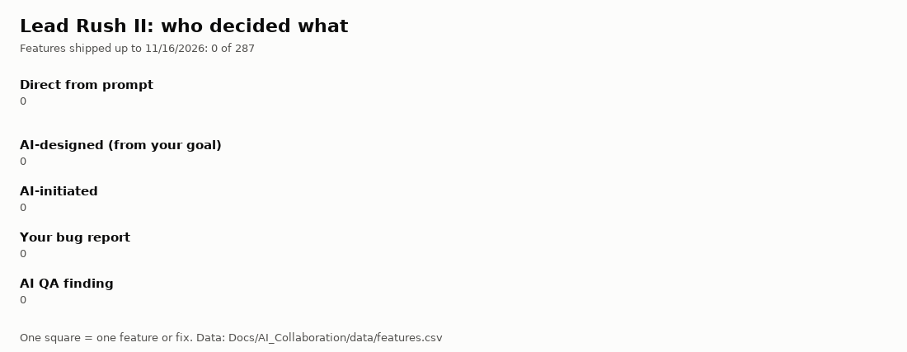
</p>

> **At a glance (original `11-16` to `11-20` case-study corpus: `270` features, `268` prompts, `87` bugs; updated ledgers through `11.24.26.1`: `287` features, `319` developer prompts / `329` archive entries, `106` bugs)**
>
> Original `11-16..11-20` baseline summarized below (`provenance.py` figures now reflect all `287` features / `319` prompts / `106` bugs):
> - **270** atomic features and fixes. The developer wrote **268** prompts (254 verbatim) and logged **87** bugs. Claude Code prompted itself **152** times.
> - **31 %** came straight from a prompt. **30 %** were designed by an AI from the developer's goal. **13 %** were AI ideas nobody asked for.
>   **21 %** began as the developer's bug report and **5 %** as an AI test or review finding.
> - The developer set the goal for **82 %** of the features. An AI chose the design for **69 %**.
> - **78 %** of finished features were kept as built. The AI-designed ones were revised most often (70 % kept).
>   All four reverts were AI design decisions.
> - Of the task prompts that could be rated for precision, **60 %** named an outcome, **37 %** named the exact means and **3 %** were open mandates.
>   The median prompt was **18 words**.

Every number on this page is reproducible from the data in [`data/`](data/) with
[`analysis/provenance.py`](analysis/provenance.py). The full list of features, one row each with the developer's words and what the AI
decided, is the [**atomic feature table**](FEATURES_TABLE.md).

**Contents:** [1. The five origins](#1-the-five-origins) ·
[2. Findings](#2-findings) ·
[3. Case studies](#3-case-studies) ·
[4. Evaluation with published methods](#4-evaluation-with-published-methods) ·
[5. Methods](#5-methods) ·
[6. Limitations](#6-limitations) ·
[7. Data, code and citation](#7-data-code-and-citation) ·
[References](#references)

---

## 1. The five origins

Each feature gets exactly one origin label. "Feature" means the smallest change a player or tester could name on its own: a mechanic,
a sound, a setting, a fix, a tool. Bundled tasks were split until each row could stand alone.

| | Origin | What it means | The test | Example (developer's words → what happened) |
|---|---|---|---|---|
| 🟦 | **Direct from prompt** | You asked for it, and your words fixed the result. | Given only the prompt, any competent developer would build essentially the same thing. | *"make the reload 1.5x faster"* → reloads are 1.5x faster (F068) |
| 🟧 | **AI-designed** (from your goal) | You asked for the outcome; an AI chose what the player actually gets: which asset, value, mechanism, rule or placement. | Different developers would build noticeably different things from the same prompt. | *"add explosion sfx when the drones explode"* → Claude picked six C4 blast recordings from your library and layered them (F239) |
| 🟩 | **AI-initiated** | Nobody asked; an AI added it. | No prompt asks for it. | the HUD armour bar, test harnesses, the API-key safety rule |
| 🟨 | **Your bug report** | You found a defect while playing; an AI found the cause and fixed it. | The trigger is a developer report of something broken. | *"the weapon keeps on going up then roating fully"* → four root causes found and fixed (F231–F236) |
| 🟪 | **AI QA finding** | An AI test, harness, cross-review or runtime check found the defect; an AI fixed it. | The trigger is an AI's evidence, before or without a developer report. | Copilot's review found fire damage counted once per hitbox (F082) |

The coder followed this decision procedure for every row:

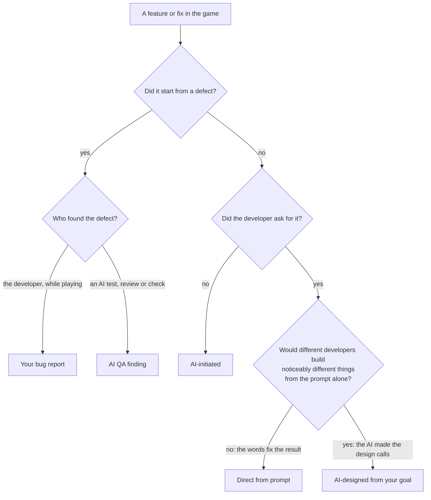

Each row also records:

- who built it, by agent and exact model;
- the prompt id and a verbatim quote of the developer's words;
- what the AI decided;
- the outcome: **kept** as built, **changed** later, **reverted**, or **open**;
- a confidence rating for the coding: 245 high, 23 medium, 2 low.

---

## 2. Findings

### 2.1 Most goals came from the developer, most designs from the AI

<picture>
  <source media="(prefers-color-scheme: dark)" srcset="figures/prov_units_dark.png">
  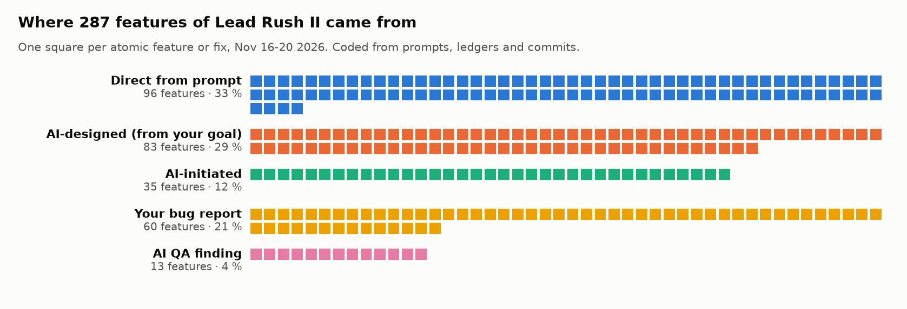
</picture>

Split the same 270 features by two questions: who decided *what* to build, and who decided *how* it works.

| | **Design chosen by the developer** | **Design chosen by an AI** | Total |
|---|---|---|---|
| **Goal set by the developer** | 84 (direct from prompt) | 138 (81 AI-designed + 57 fixes to your bug reports) | **222 (82 %)** |
| **Goal set by an AI** | 0 | 48 (35 AI-initiated + 13 fixes to AI findings) | **48 (18 %)** |
| **Total** | **84 (31 %)** | **186 (69 %)** | 270 |

The developer was the main source of intent. The AI was the main source of design. The developer never specified the design of an
AI-initiated item. That cell is empty by construction, because the AI only proposed those items after the fact.

### 2.2 Where the developer specified, and where the AI designed

<picture>
  <source media="(prefers-color-scheme: dark)" srcset="figures/prov_by_area_dark.png">
  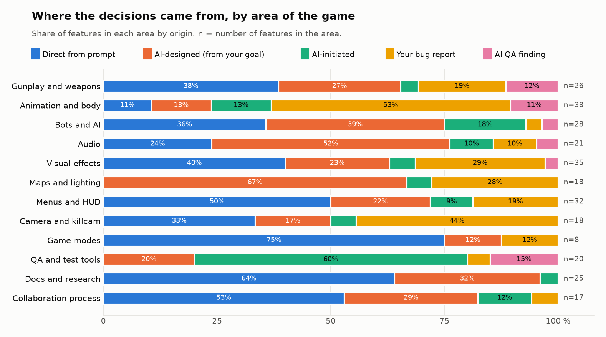
</picture>

- **The developer specified rules and menus.**
  - Game modes: 75 % direct.
  - Docs and research: 62 % direct.
  - Menus and HUD: 47 % direct.
  - The prompts here name concrete things: *"have the current game mode be 1v1 deathmatch"*, *"show map on the bottom like bf6 … above the healht bar"*.
- **The AI designed the look and sound.**
  - Maps and lighting: 71 % AI-designed, none direct.
  - Audio: 55 % AI-designed.
  - Bots and AI: 44 % AI-designed, plus 20 % AI-initiated.
  - The prompts here are moods: *"dark, gungy, war torn, damaged"*, *"more realistic and grand … gritty wartorn"*.
- **Animation was mostly debugging.** 53 % of animation features are fixes to the developer's bug reports, more than any other area.
  - The two-rig full-body setup is the cause. A hidden Kinemation rig animates and a visible soldier copies its pose every frame (see [3.7](#37-the-weapon-flip-four-root-causes-one-guard-withdrawn)).
  - It made bugs that only show up while playing.
- **The AI built its own instruments.** 60 % of QA and test tools are AI-initiated: pose checks, grip checks, death and wall harnesses, the weapon-flip black box.

### 2.3 Who built what

<picture>
  <source media="(prefers-color-scheme: dark)" srcset="figures/prov_by_agent_dark.png">
  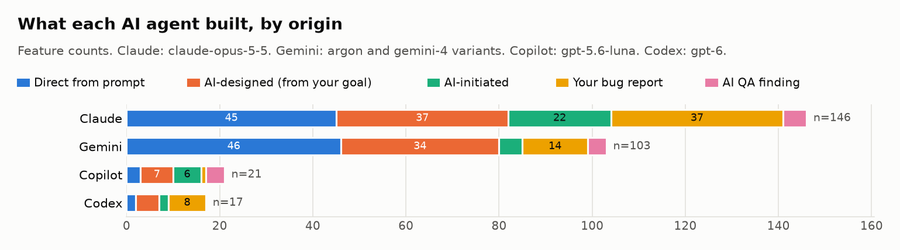
</picture>

| Agent and model | Features | Direct | AI-designed | AI-initiated | Your bug report | AI QA finding |
|---|---|---|---|---|---|---|
| Claude · `claude-opus-5-5` | 146 | 45 | 37 | 22 | 37 | 5 |
| Gemini · `argon`, `gemini-4-hydrogen`, `-high`, `orchestrator-neon` | 86 | 34 | 32 | 5 | 11 | 4 |
| Copilot · `gpt-5.6-luna` | 21 | 3 | 7 | 6 | 1 | 4 |
| Codex · `gpt-6` | 17 | 2 | 5 | 2 | 8 | 0 |

Claude handled most of the developer's bug reports (37 of 57) and most AI-initiated work (22 of 35). That matches its board role, which
was the hard bugs and coordination. Most of Gemini's work was direct and AI-designed features (66 of 86), with few bug fixes. Codex
joined on day three, and about half of its work fixed reported bugs.

### 2.4 How the work moved over five days

<picture>
  <source media="(prefers-color-scheme: dark)" srcset="figures/prov_by_day_dark.png">
  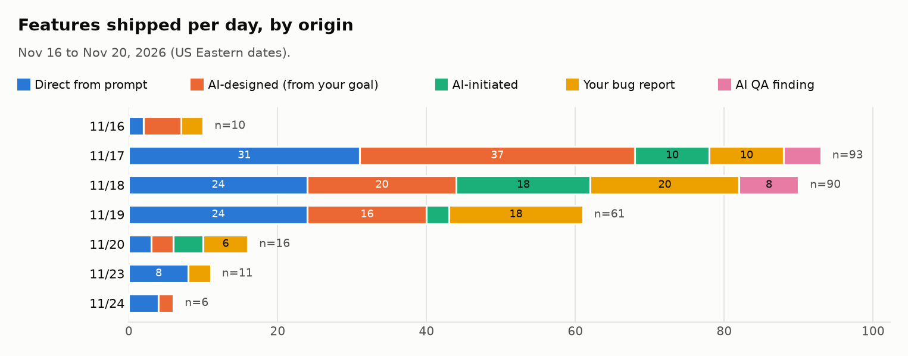
</picture>

<picture>
  <source media="(prefers-color-scheme: dark)" srcset="figures/autonomy_timeline_dark.png">
  
</picture>

- **Nov 17 was the busiest day for the developer.** They sent 118 prompts, many of them to Gemini overnight, and 93 features shipped.
- **From Nov 18 the agents worked more on their own.** Claude Code scheduled a 20-minute "coordinator tick" for itself. In each tick it checked the board, reviewed other agents' work and continued its own rows.
  - Over Nov 18 to 20 it prompted itself **152 times**.
  - Over the same three days the developer prompted all agents **137 times**.
- **AI-initiated work peaked on Nov 18 (18 items).** That is the day the cross-review rules and test harnesses started.

### 2.5 How the developer asked

<picture>
  <source media="(prefers-color-scheme: dark)" srcset="figures/prompt_specificity_dark.png">
  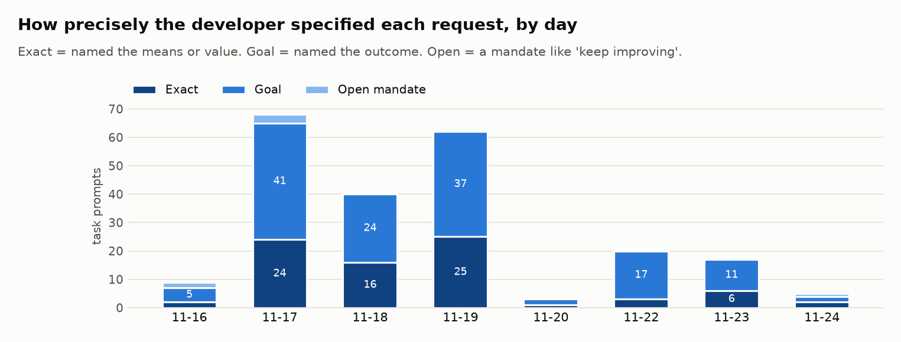
</picture>

- **The prompts were short.** The median was 18 words. The longest (P198, 395 words) bundled more than twenty requests.
- **Most named an outcome, not a means.** Of the 182 task prompts that could be rated for precision:
  - **60 %** named only the outcome (*"make the colors consistent through the game"*);
  - **37 %** named the exact means or value (*"use x to hold crouch"*, *"maybe 50 armor and 100 health"*);
  - **3 %** were open mandates (*"keep on improving upon the game, until you run out of token"*).
- **The open mandates all came in the first two days.** After that the developer always named at least a goal.
- **Claude got more exact prompts than Gemini** (39 % against 32 %). The developer gave Claude the bugs and the precise tuning, and gave Gemini open-ended build-outs.

### 2.6 One prompt, many decisions

<picture>
  <source media="(prefers-color-scheme: dark)" srcset="figures/elaboration_dark.png">
  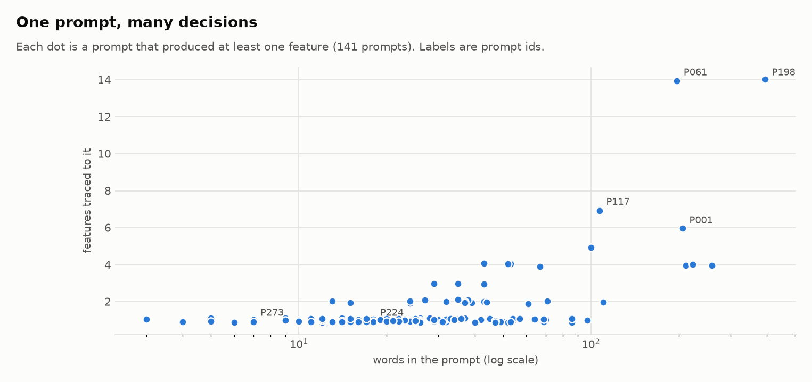
</picture>

- **Most features trace back to a prompt.** 208 of the 270 (77 %) map to a specific prompt, and 128 prompts produced at least one feature.
- **Most prompts produced one or two features.**
- **Long, list-like prompts produced many.**
  - P061 (197 words, Nov 17 18:00) and P198 (395 words, Nov 19 00:27) each became **14** separate features.
  - Each feature then carried its own design decisions.
- **Short prompts still left design to the AI.** 10 AI-designed features came from prompts of 15 words or fewer.

### 2.7 Who found the bugs

<picture>
  <source media="(prefers-color-scheme: dark)" srcset="figures/bug_finders_dark.png">
  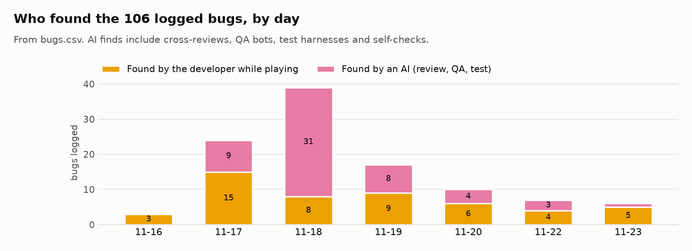
</picture>

**Who found them:** of the 87 logged bugs, the developer found **39** while playing. AIs found **48**:

| Finder | Bugs |
|---|---|
| Claude reviews | 18 |
| Claude self-checks | 6 |
| Gemini reviews | 6 |
| Copilot reviews | 6 |
| Runtime checks | 6 |
| QA bot | 3 |
| Codex reviews | 2 |
| Push check | 1 |

**When they were caught:**

- 45 were caught at review or by the push check, before the developer ever saw them.
- 42 escaped into a build the developer played. The developer found 39 of those; AI runtime checks found the other 3.
- The AI share peaked on Nov 18, the day the cross-review protocol took effect: 31 of 39 bugs that day.

### 2.8 What survived

<picture>
  <source media="(prefers-color-scheme: dark)" srcset="figures/prov_kept_dark.png">
  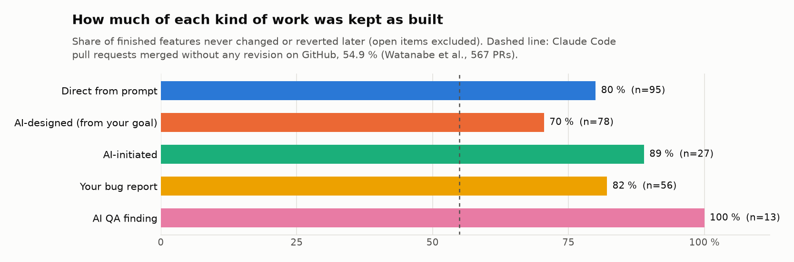
</picture>

| Origin | Kept | Changed later | Reverted | Open |
|---|---|---|---|---|
| Direct from prompt | 64 | 19 | 0 | 1 |
| AI-designed | 53 | 21 | 2 | 5 |
| AI-initiated | 24 | 3 | 0 | 8 |
| Your bug report (fixes) | 43 | 8 | 2 | 4 |
| AI QA finding (fixes) | 13 | 0 | 0 | 0 |

**AI-designed features were revised most often** (70 % kept). This is where the AI's taste met the developer's. Most changes were
follow-ups in the developer's words:

- *"make it slomo a bit more"*;
- *"less offensive. cool and funny"*;
- *"it should be in the middle"*.

**Every reverted item was an AI design decision**, in two kinds:

- **Mechanisms the AI chose, which later broke something:** the ADS sight lock (F179) and the turn-in-place tuning (F214).
- **Fixes whose method the AI chose:** grip offsets iteration 1 (F229) and the weapon flip guard (F235).

Section [3.8](#38-when-the-ais-design-was-rolled-back) covers them.

---

## 3. Case studies

Each case shows what the developer wrote, what the prompt left open, what the AI decided, and how it ended.

### 3.1 The drone explosion: which sound, from your library

| | |
|---|---|
| **You wrote** | *"add explosion sfx when the drones explode"* (P273, Nov 19 20:40, 7 words) |
| **Left open** | Which recording, how loud, how far it carries, how it combines with what was already there. |
| **What the AI decided** | See the list below. |
| **Outcome** | Kept (B126, F239). Built by Claude, `claude-opus-5-5`. |

What Claude found and decided:

- **It checked the existing sound first.** The drone already played a sound on death, but all six clips in that set were falling concrete. The game had debris but no blast.
- **It searched your library.** Your private Modern Warfare SFX folder had both frag and C4 explosion recordings. Claude chose the six **C4 blast-body** takes (`c4_expl_body_01..06`) as a new `droneExplode` set.
- **It kept the debris as a tail.** The old debris set now plays **50 ms after** the blast, at 0.8 volume.
- **It tuned how the blast plays:**
  - full volume;
  - audible from 4 m to **90 m**;
  - random pitch between 0.94 and 1.06, so repeats don't sound identical;
  - high voice priority, so the blast is never culled.
- **It kept the clips private.** They stay in the git-ignored audio folder like your other ripped audio, so they never reach GitHub.

This is the developer's own example of an "improvement over the request". The request fixed the event, and every audible property was
an AI choice.

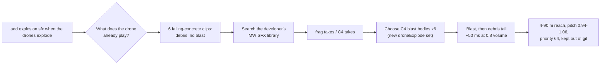

### 3.2 "Health 1.5x": you refined your own request, the AI filled in the rest

| | |
|---|---|
| **You wrote** | *"make the overall health 1.5x (or bullet damage less)"* (P178, Nov 18 04:17). Two minutes later: *"dont show health as 150. maybe 50 armor and 100 health . have armour breaking sound too. and maybe have armor in the ammo stations too?"* (P179) |
| **What you decided** | 100 HP plus 50 armour instead of 150 HP; an armour-break sound; armour refills at the ammo stations. All three are coded **Direct** (F133–F135). |
| **What the AI decided** | See the list below. |
| **Outcome** | Kept and verified by Gemini's review. |

What the AI added:

- **Armour rules.**
  - Armour soaks damage first and passes the overflow to health.
  - Fire bypasses armour.
  - Armour doesn't regenerate.
- **A procedural "ceramic shatter" break sound** with a hitmarker vibration.
- **Station refill rules:** 50 armour per refill, on a 20-second shared cooldown.
- **A segmented HUD armour bar** that nobody asked for (F136, AI-initiated).
- **Bots that resupply at ammo stations.** Claude proposed that bots go back to a station when their armour breaks or their ammo runs low, but only when out of the fight. Gemini built it (F138, AI-initiated).

<p align="center">
  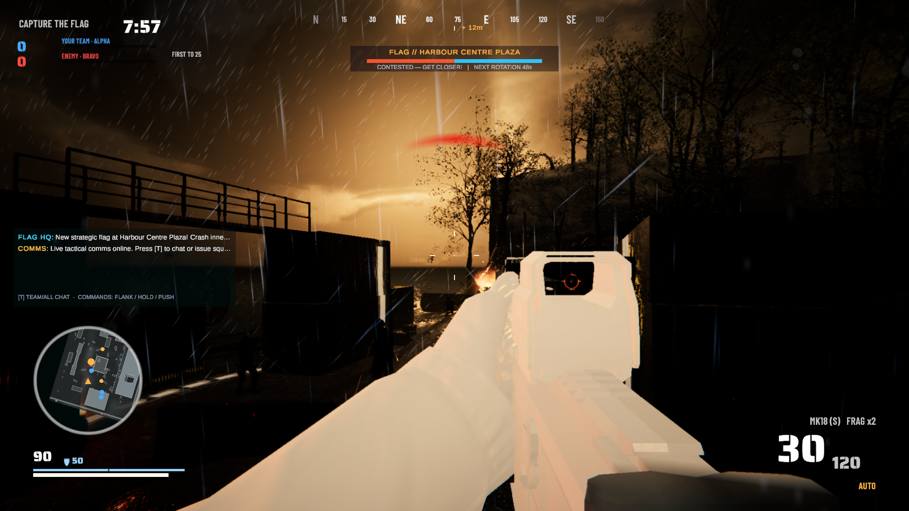
  
</p>

### 3.3 Human-like aim: you named the method, the AI picked the data and checked the cost

| | |
|---|---|
| **You wrote** | *"during ai v ai, when they are scoping around, turning etc, they turn very roboticly. humans dont do that. look at human mouse moving data, fit a cruve through it and then try to mimic that realistic human like movement"* (P229). Then: *"also make sure the accuracy K/D does not drop or alter a lot after making these changes"* (P232) |
| **What the AI decided** | See the list below. |
| **Outcome** | Kept (F215, F216). Built by Claude. |

What Claude decided:

- **The dataset:** the public Balabit mouse-dynamics recordings, **4,636** human mouse movements.
- **The model:** the curve family it fitted to them, and how the bots use it when they look around and turn.
- **A check on the cost.** Claude built an A/B bench: 150 s of AI vs AI, one bot per difficulty on each team, the same presets on both sides.
  - Accuracy was 14.2 % with the old aim and **15.1 %** with the human aim.
  - Kills were 72 and 71.
  - Per difficulty, the differences were within noise.

The developer named the method, so the coding of F215 as AI-designed is a judgement call. The deciding choices were which data, which
curve and how to apply it, and the AI made all three.

<p align="center">
  
</p>

### 3.4 Even difficulty steps: from "vet is too strong" to a Monte Carlo model

| | |
|---|---|
| **You wrote** | *"vet is vastly more superior from the rest. can that be tweaked a bit? like let the skill gap between each setting be somewhat similar?"* (P247) |
| **Left open** | How to measure a "skill gap", and what to change. |
| **What the AI decided** | See the list below. |
| **Outcome** | Kept (F221). Built by Claude. |

What Claude decided:

- **How to measure the gap:** a Monte Carlo model that simulates many duels using the game's own formulas.
- **How to close it:** one skill dial for all presets, and a slightly weaker Veteran.
- **The result:** each preset's simulated win rate against the preset below it moved from 96 / 94 / 92 % to **91 / 90.5 / 91 %**.
  The kill times are 5.9 / 3.7 / 2.5 / 1.8 s from the easiest preset to the hardest.

The developer's word *"similar"* became a measured, flat ladder.

### 3.5 One colour rule

| | |
|---|---|
| **You wrote** | *"make the colors consistent through the game. red and blue in menu, but different inside gameplay is weird."* (P224) |
| **What the AI decided** | See the list below. |
| **Outcome** | Kept (F209). Built by Claude. |

The rule Claude chose:

| Mode | Colours |
|---|---|
| Teams | Alpha blue (your team), Bravo red, Charlie green, Delta gold |
| Free for all | You blue, everyone else red |

It applied the rule in ten places:

- uniforms
- lasers
- the kill feed
- the minimap
- the scoreboard
- the chat
- the score panel
- the capture zone
- the spectator view
- the lobby

The developer named the problem. The AI wrote the rule and found every place it had to hold.

<p align="center"></p>

### 3.6 Friends' gamer tags: ten prompts of developer control

This is the clearest case of the developer keeping authority over a decision. The topic was social and personal: real friends' names
used as bot tags.

| When | You wrote | What changed |
|---|---|---|
| Nov 18 12:57 | *"add a gamer tag there "EnchantedP0tato" … have these names tweked to turn to gamer tags: "Jack, Ashlesha, Claypool, Tokey, Xiaokun" … 2 more best ones from current"* | Friends' tags added; the AI wrote the tag versions (F222) |
| 13:12 | *"keep all the old ones too, add the new naems just make them more frequent"* | Old tags kept, friends weighted up |
| Nov 19 12:57–13:00 | *"remove ashlesha xiokun claypool and jack from the bot names … Or maybe have them all be present when multiple bots are playing. generate new gamer tags for them"*, *"less offensive. cool and funny"*, *"no more names."*, *"tokey too. regen that too"* | Tags regenerated, toned down (F224) |
| 13:13 | *"was the gamer tag thing done? i dont see anyones name anymore"* | Developer checked the result |
| 13:16 | *"play under tags that hide their names, like Pix"* then *"noooo dont hide their names. keep their names too"* | Names kept visible |
| 13:30 | *"during 1v1 dont show friends name as much, when multiuple and when u can put them all … then show their names"* | AI rule: friends play together only when all of them fit (6 or more bots); in small matches they appear only now and then (F223) |

Every step except the wording of the tags and the final 6-bot threshold was the developer's call. All three features here are coded
**Direct**.

### 3.7 The weapon flip: four root causes, one guard withdrawn

| | |
|---|---|
| **You reported** | *"the weapon keeps on going up then roating fully. that is a primary fix. happens to all the weapons"* (P263, Nov 19 14:27), then six more messages with symptoms and hypotheses over seven hours |
| **What the AI did** | Built a per-frame flip detector with a 40-frame "black box" recorder and layer ablation switches, ran A/B benches, and found four separate causes |
| **Outcome** | Fixed and measured (F230–F237). Built by Claude. The first fix, a clamp, was later switched off because the real causes were gone. |

The developer's observations steered the search, and two of the four hypotheses were right:

| Your observation or hypothesis | What the measurements showed | Verdict |
|---|---|---|
| *"mainly after the latest finger changes u did maybe... fix them revert them back"* (14:27) | The grip change had already been reverted at 13:21 for a spinning arm; flips continued in the benches. | Not the flip cause (it did cause the arm spin, D77) |
| *"it mainly happens probably duing collision with other stuffs"* (14:36); *"its happenning during ads, when i hit other obstacles and maybe death has something to do with it"* (18:47) | Aiming into a wall swung the rifle **22.8°**, and dying against a wall swung it **22.9°**. The wall tuck ran at full strength while aiming. | **Right** (D86) |
| *"the gun issues did not exist yesterday. some IK stuff was changed"* (20:39) | Git history: the COD-like wall tuck was added on Nov 18 at 19:15, as Claude's fix for your earlier wall report (F144). | **Right**: an earlier AI fix caused it |
| *"maybe somethings getting super multiplied in the ik of idle in some cases"* (21:43) | The black box showed single-frame 60–180° spikes in bots. Shared motion curves were being read by several animation threads at once (a data race, not a multiplication). | Partly right (D84) |
| (not reported) | Hit flinches bent the hidden rig *after* its pose was copied. | AI-only finding (D85) |
| (not reported) | LR2's own after-animation gun edits fed back into the next frame. | AI-only finding (D87) |

| Measure (before → after) | Before | After |
|---|---|---|
| Player: rifle swing aiming into a wall, head-on | 22.8° | 3.4° |
| Player: dying against a wall while aiming | 22.9° | 3.6° |
| Player: aiming at 45° into a wall | 10.5° | 1.9° |
| Bots: single-frame spikes, two matches | 7 and 23 | 0 and 0 |
| Bots: largest gun swing, two matches | 179° and 177° | 64° and 67° |
| Bots: ADS jitter events, two matches | 64 and 66 | 1 and 0 |
| Bots hit while aiming: frames over 60° | 286 | 28 |

This case shows the debugging origin at its most useful. The developer supplied symptoms and good hunches. The AI supplied instruments
and causes. Each fix went in only after a measurement confirmed its cause. The full IK walkthrough is in the
[weapon IK report](../Animation/weapon-ik-report.html).

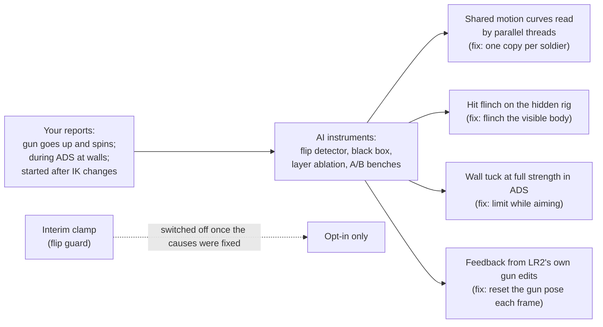

### 3.8 When the AI's design was rolled back

| Feature | The AI's decision | Why it was rolled back | Who rolled it back |
|---|---|---|---|
| ADS sight lock (F179) | To meet *"the reticle should never move fully away … like COD or BF"*, Claude locked the front sight within 0.35° of the view after the animation ran. | The developer reported that the lock pulled the view (D70). | Codex replaced it with lower sway inside the animation profile (F180) |
| Faster turn in place (F214) | 50° threshold instead of 90°, a 0.45 s unwind instead of 1 s, turn clips 1.7x faster. | During the gun-swing hunt, Claude returned the turn settings to Kinemation's stock values as a precaution. | Claude (self-revert) |
| Grip offsets, iteration 1 (F229) | New hand offsets for all five guns. | The developer saw a bot's whole arm spinning while spectating and asked to *"remove anything forced"* (D77). | Claude, at the developer's request |
| Weapon flip guard (F235) | An after-animation clamp for flipped guns. | It was no longer needed after the four root causes were fixed and measured without it. | Claude (made opt-in) |

All four were the AI's own mechanisms. None were prompt-specified features. For a researcher, this is the cost side of "improvement
over the request". When the AI chooses the mechanism, the developer only finds the problems by playing.

### 3.9 The LLM squad commander: your constraints, the AI's rules (tested live in `11.23.26.1`)

| | |
|---|---|
| **You wrote** | *"can you implement a system to control the commander thing. with LLM? i'll input groq api. using free tier only. build it first then we'd test how it is performing against out non llm bots."* (P271) |
| **What you decided** | The provider (Groq), the budget (free tier only), the experiment (LLM teams against rule bots). |
| **What the AI decided** | See the list below. |
| **Outcome** | **Verified (`11.23.26.1`):** Tested live across 8 × 75s 4v4 Saltworks matches (`M1–M8`) against Recruit, Regular, Hardened & Veteran rule bots; expanded into 3 integration depths (`Commander`, `TacticalMicro`, `AvatarPilot`). See [`LLM_BOT_STUDY.md`](LLM_BOT_STUDY.md) and [`llm-architecture.html`](../Bot/llm-architecture.html). |

What Claude decided:

- **Fair information (F241, AI-initiated).** The commander sees only what its team knows, such as last-known enemy positions, never the true state.
- **Model and pacing.**
  - A model fallback chain.
  - An order every 12 s, with at least 2.5 s between requests and back-off when the API says to slow down.
- **How orders run.** Orders become directives for the existing bots, lasting 1.6 times the interval. Each order is posted to the squad chat (F242, AI-initiated).
- **Logging.** A log line for every call, and a per-team K/D table for the comparison (F243).
- **Key safety (F244, AI-initiated).** The API key is read from an environment variable, a launch flag or a local file, and never logged or committed.

---

## 4. Evaluation with published methods

The developer asked how published research separates human and AI decisions, and for the same kinds of evaluation here. These are the
closest studies, what they measured, and how each method was applied to Lead Rush II.

| Study | What it measures | How | Applied here | Result here |
|---|---|---|---|---|
| Anthropic Economic Index: software development (2025) | Automation vs augmentation in Claude Code and Claude.ai conversations: directive, feedback loop, task iteration, validation, learning | Privacy-preserving classification (Clio) of 500,000 coding conversations | The same five patterns, hand-coded per developer prompt | 66 % automation (directive + feedback), against 79 % for Claude Code and 49 % for Claude.ai coding |
| Watanabe et al., agentic pull requests (2025) | How often Claude Code PRs are merged, and merged without revision; what reviewers change | Manual coding of 567 agentic and 567 human PRs; two annotators (κ = 0.49 on rejection reasons) | "Kept as built" per origin; revisions by kind | 78 % of finished features kept as built; 70 % for AI-designed, 77 % for direct |
| He, Houde & Weisz, credit in human-AI co-creation (CHI 2025) | How much credit people give a human or AI partner by contribution type, amount and initiative | Scenario survey, 155 knowledge workers, 2x3 between-subjects | Initiative (who set the goal) x design (who chose how) | Goals 82 % developer; design 69 % AI; an attribution statement below |
| IBM AI Attribution Toolkit (2025) | A disclosure statement: how much the AI did, what it contributed, who reviewed | Voluntary questionnaire that generates a statement | Answered for this project | [Statement](#43-an-ai-attribution-statement) |
| Feng, McDonald & Zhang, levels of autonomy (2025) | The user's role: operator, collaborator, consultant, approver, observer (L1–L5) | Conceptual framework; "assisted evaluation" by logged involvement | Developer prompts vs agent self-prompts per hour | Collaborator (L2) in interactive sessions; approver (L4) during overnight runs and self-ticks |
| Parasuraman, Sheridan & Wickens (2000) | Which information-processing stage is automated: acquisition, analysis, decision selection, action | Model of types and levels of automation | Which stage the developer kept, by origin | The developer kept decision selection only for direct features (31 %) |
| Guzdial et al., AI in a game level editor (CHI 2019) | The roles creators project onto an AI: friend, collaborator, student, manager | Two studies, 100+ participants, think-aloud with 14 designers | Roles by origin | Student (direct), collaborator (AI-designed), manager (cross-review that reopened work) |
| Barke, James & Polikarpova, Grounded Copilot (OOPSLA 2023) | Acceleration (you know what you want) vs exploration (you don't) | Grounded theory, 20 programmers | Exact vs goal prompts | 37 % exact (acceleration-like), 60 % goal (exploration-like) |
| Mozannar et al., CUPS (CHI 2024) | Time spent in each programmer state with an AI assistant | 21 programmers labelled their own screen recordings (3,000+ labels) | The developer labels a blind sample of features | Sheet ready; agreement pending |
| Lee, Liang & Yang, CoAuthor (CHI 2022) | Who wrote which text, keystroke by keystroke, in 1,445 sessions | Full interaction logging and replay | Provenance chain: prompt → board row → task → commit → feature | 77 % of features traced to a specific prompt |
| Rezwana & Maher, COFI (ACM TOCHI 2023) | Interaction design of co-creative systems: collaboration style, communication style, creative process, creative product | Framework applied to 92 systems | Lead Rush II described in those terms | Turn-taking by prompts; parallel agents in lanes; mixed initiative in 18 % of features |
| Yannakakis, Liapis & Alexopoulos, mixed-initiative co-creativity (FDG 2014) | Whether the computer fosters the human's creativity, not just produces content | Evaluation of a game-design tool (Sentient Sketchbook) | Fate of AI-initiated work | 89 % of finished AI-initiated items kept |
| Becker et al. (METR), RCT on AI and developer speed (2025) | Whether AI tools make experienced developers faster | Randomised trial, 16 developers, 246 tasks: 19 % slower with AI, while they believed 20 % faster | A caution, not a method | No productivity claim is made here |

### 4.1 Interaction patterns (Anthropic Economic Index)

<picture>
  <source media="(prefers-color-scheme: dark)" srcset="figures/prompt_patterns_dark.png">
  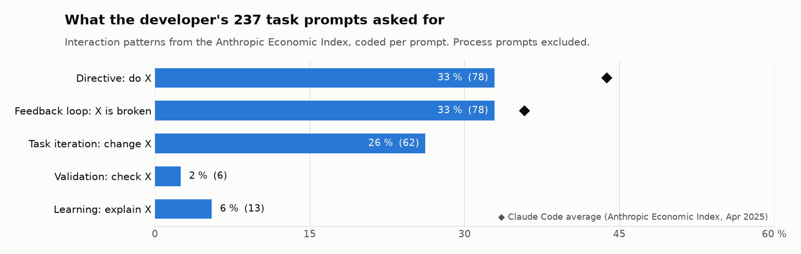
</picture>

<picture>
  <source media="(prefers-color-scheme: dark)" srcset="figures/automation_share_dark.png">
  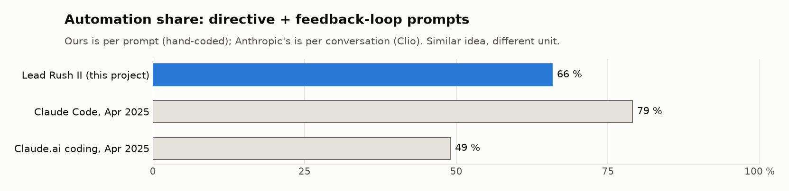
</picture>

**Applying the patterns.** Each of the 268 developer prompts was coded with one of Anthropic's five collaboration patterns, or as
process. Process prompts are coordination like "continue", "unity closed" or "start copilot". There were 72, and they were excluded
from the shares, like Anthropic's "could not classify".

**The result.** Of the 196 task prompts:

| Pattern | Share |
|---|---|
| Directive (*do X*) | 35 % |
| Feedback loop (*X is broken*) | 31 % |
| Task iteration (*change X*) | 26 % |
| Learning | 4 % |
| Validation | 3 % |

That is **66 % automation**, which sits between Claude Code (79 %) and Claude.ai coding (49 %).

**Why it is lower than Claude Code.** The developer iterated a lot: 52 prompts refined something already built, such as tile sizes,
colours or names. This project was a game, judged by feel, so a quarter of the prompts were "change it again".

**Caveat on the comparison.** Anthropic classifies whole conversations with an automated tool. Here one person coded single prompts.
The two shares are comparable in kind, not in method.

### 4.2 Acceptance without revision (Watanabe et al.)

Watanabe et al. found that **54.9 %** of merged Claude Code pull requests went in with no further changes. Here, **78 %** of finished
features were kept as built (figure in [2.8](#28-what-survived)).

The two are not directly comparable:

- A pull request bundles many decisions, and a feature row is one.
- Here "revision" means a later change at the developer's request or by a later fix.

**The pattern inside the data matters more than the comparison.**

- **AI-designed features were the least stable.** 70 % were kept, against 77 % for direct features and 89 % for AI-initiated ones.
- **AI design produced the reverts.** All four reverts came from mechanisms the AI chose.

### 4.3 An AI attribution statement

He, Houde and Weisz found that people credit AI less than a human for the same contribution. They also found that the *type* of
contribution matters most to credit, ahead of amount and initiative. IBM's AI Attribution Toolkit turns this into three questions.
Here are the answers for Lead Rush II, from the data:

1. **How much of the work did the AI do?**
   - The agents did all the implementation, testing and documentation in the ledgers: 207 tasks.
   - The developer wrote 268 prompts, play-tested every build and found 39 of the 87 logged bugs.
2. **What did the AI contribute?**
   - **Content.** The AI chose the design of 69 % of the features (186 of 270) and initiated 18 % (48) without being asked.
   - **Form.** The developer specified 31 % of features precisely enough that the AI's role was execution.
   - The AI's contributions were mostly content (mechanisms, rules, assets, values), not only form.
3. **Who reviewed and approved the work?**
   - The developer, by playing every build.
   - The agents, by cross-review: 45 bugs were caught at review or by the push check.

> *Short form:* Lead Rush II was directed by a human developer who set 82 % of the goals. AI agents (Claude Code `claude-opus-5-5`, Gemini
> `argon`/`gemini-4-hydrogen`, Copilot `gpt-5.6-luna`, Codex `gpt-6`) designed 69 % of the features, initiated 18 % and implemented all of them.
> The developer reviewed the work by play-testing; the agents cross-reviewed each other.

### 4.4 Levels of autonomy (Feng, McDonald & Zhang; Parasuraman et al.)

The developer's role changed across the project. Feng et al. define five user roles: operator (L1), collaborator (L2), consultant (L3),
approver (L4) and observer (L5).

| Phase | Evidence | Developer's role |
|---|---|---|
| Nov 16, single agent, interactive | Prompt, play, prompt; *"continue"* after usage limits | **Collaborator (L2)** |
| Night of Nov 16–17, Gemini alone | *"i closed unity and am going to sleep. keep on making fixes and improvements until u run out of token"* | **Approver (L4)**: work reviewed the next morning |
| Nov 17–19, multi-agent board | Agents divide lanes, cross-review and reopen each other's rows; the developer reports bugs and re-prioritises (*"no first fix are the animations, then boxy flames, then the bot"*) | **Consultant (L3) to approver (L4)** |
| Nov 18–20, self-prompting | 152 coordinator ticks by Claude against 137 developer prompts | **Approver (L4)** for routine work, **collaborator (L2)** for feel and taste |

In Parasuraman et al.'s terms, the agents always did *information acquisition* (reading code, logs and measurements), *analysis* and
*action implementation*. The stage the developer kept was *decision selection*, and only for the 31 % of features coded direct. For
the rest, the developer acted at the edges: setting goals before, and judging by play after.

### 4.5 Roles the developer gave the AI (Guzdial et al.)

Guzdial et al. found that creators treat an AI partner as a **friend**, **collaborator**, **student** or **manager**. Three of those
roles map onto this project:

- **Student** (follows the creator's instructions): the 84 direct features.
- **Collaborator** (an equal design partner): the 81 AI-designed features.
  - The developer's follow-ups read like a conversation with a partner: *"sorry they exist my bad"*, *"keep their names too"*.
- **Manager** (judges the creator's or others' work): the cross-review lane.
  - Agents set each other's rows to VERIFIED or REOPENED, and caught 45 bugs before the developer saw them.
  - The developer turned this on with *"you should also check geminis work after its done, and it should check yours"* (P066).

### 4.6 Reliability of the coding (Mozannar et al.; Watanabe et al.)

Studies that code human-AI work use two coders and report agreement (Watanabe et al.: κ = 0.49 on rejection reasons). Mozannar et al.
go further and have participants label their own sessions.

**How this page was coded.** One coder (Claude, `claude-opus-5-5`) labelled every row, with a verbatim quote and ids so anyone can
check it.

**The blind check.** [`data/provenance_validation.csv`](data/provenance_validation.csv) holds **40 randomly sampled features**, 8 per
origin, without the AI's labels.

- The developer is the ground truth for "did I decide this?", so the developer fills in `developer_label` using the codebook letters
  (`dir`, `ai`, `init`, `dbug`, `qa`).
- Running the script then reports Cohen's κ and percent agreement.

**Status:** pending, so treat the shares above as one coder's reading of the record.

---

## 5. Methods

**Data sources** (all in this repository):

| Source | What it gives |
|---|---|
| [`PROMPTS.md`](PROMPTS.md) | Every developer prompt to every agent, verbatim where the logs allow, in US Eastern time. 254 verbatim and 14 quoted from session summaries. |
| [`data/tasks.csv`](data/tasks.csv) | 207 delivered tasks with agent, exact model, outcome and source prompt |
| [`data/bugs.csv`](data/bugs.csv) | 87 bugs: who found each, at which stage, which task caused it |
| [`AGENT_COORDINATION.md`](../../AGENT_COORDINATION.md) | Board rows B1–B128: owner, model, status, evidence |
| Git history | Commits that implemented or reverted each feature |
| Claude Code session log (not in the repo) | Mid-turn messages and the 152 self-prompting ticks, counted into [`data/autonomy_ticks.csv`](data/autonomy_ticks.csv) |

**Unit of analysis.** An *atomic feature* is the smallest change a player or tester could name on its own, including tools and
process rules. Tasks that bundled several changes were split, for example C63 into rain, splashes, post-processing, banter and a camera
filter. Reviews were not counted as features, because their findings appear as the fixes they caused.

**Coding.** For each feature, the coder:

1. read its ledger and board evidence;
2. found the prompt that started it;
3. quoted the developer's words verbatim;
4. wrote down what the prompt left open and what the AI decided;
5. applied the [decision procedure](#1-the-five-origins).

The *replication test* (would different developers build noticeably different things from this prompt alone?) separates **Direct**
from **AI-designed**. Outcomes are as of Nov 20, 2026, 12:30 ET.

**Prompt coding.** Each prompt got two codes:

- **Pattern**, after the Anthropic Economic Index: directive, feedback loop, task iteration, validation, learning, or process.
- **Specificity**:
  - **Exact**: names the means, value, asset or rule.
  - **Goal**: names the outcome.
  - **Open**: a mandate.

Multi-request prompts get the pattern of their main request.

**Reproduce.**

```
pip install matplotlib pillow
python Docs/AI_Collaboration/analysis/provenance.py                    # figures, tables, FEATURES_TABLE.md, stats
python Docs/AI_Collaboration/analysis/provenance.py --rebuild-prompts  # re-parse PROMPTS.md, keep the codes
```

<p align="center">
  
</p>

---

## 6. Limitations

- **The coder is a participant.** Claude coded the data and also built 146 of the 270 features. Studies show people under-credit AI
  (He et al.) and under-disclose its role (the "AI ghostwriter effect", Draxler et al.). An AI coder may lean the other way.
  - *Mitigation:* every row carries the developer's verbatim words, so a reader can re-judge it. The blind validation sheet exists for this.
- **The prompt log is not complete.**
  - Codex's prompts and some Gemini handoffs were not logged verbatim. 14 prompts are quotes from session summaries.
  - 62 features (23 %) have no single source prompt. Most are AI-initiated items, review findings and work handed over between agents.
- **Granularity shapes the shares.** Splitting bundled tasks into atomic rows gives more weight to feature-rich prompts. A coarser unit
  such as tasks or pull requests would give different percentages, but the same ordering.
- **"Kept" is a snapshot.** Outcomes are as of Nov 20. Features still open (18) or untested, such as the LLM commander, may change.
- **Bugs are logged bugs.** Early bugs (Nov 16–17) were reconstructed from prompts. Bugs nobody logged are missing.
- **The time is US Eastern.** Self-prompting ticks are counted only from Claude's log. Gemini's, Copilot's and Codex's own internal
  loops are not counted.
- **No productivity claim.** METR's randomised trial found experienced developers 19 % slower with AI tools while they believed they were
  faster. This page describes who decided what, not whether it was faster than working alone.

---

## 7. Data, code and citation

| File | Contents |
|---|---|
| [`FEATURES_TABLE.md`](FEATURES_TABLE.md) | The atomic feature table as a readable page, grouped by area |
| [`data/features.csv`](data/features.csv) | 270 rows: id, date, area, feature, origin, agent, model, board row, task, bug, prompt id, confidence, developer's words, AI's decision, outcome |
| [`data/prompts.csv`](data/prompts.csv) | Every prompt with date, time, recipient, source, word count, pattern and specificity |
| [`data/autonomy_ticks.csv`](data/autonomy_ticks.csv) | Claude Code's self-prompting ticks per hour |
| [`data/provenance_validation.csv`](data/provenance_validation.csv) | The blind sample for the developer to label |
| [`data/provenance_stats.json`](data/provenance_stats.json) | Every number on this page, machine-readable |
| [`figures/provenance_summary.md`](figures/provenance_summary.md) | The numbers as tables |
| [`analysis/provenance.py`](analysis/provenance.py) | The script that builds all of the above |

Related pages:

- [README.md](README.md): the story of the collaboration.
- [PROTOCOL.md](PROTOCOL.md): the coordination protocol.
- [QA_PROCESS.md](QA_PROCESS.md): how the agents test the game.
- [PROMPTS.md](PROMPTS.md): every prompt.

**Cite as:** *Lead Rush II decision-provenance dataset (2026). Who decided what: human and AI decisions in a five-day multi-agent game
build. https://github.com/Tokey/Lead-Rush-2/tree/main/Docs/AI_Collaboration*

---

## References

1. Anthropic (2025). *Anthropic Economic Index: AI's impact on software development.* https://www.anthropic.com/research/impact-software-development
2. Anthropic (2025). *The Anthropic Economic Index.* https://www.anthropic.com/research/the-anthropic-economic-index
3. Watanabe, M., Li, H., Kashiwa, Y., et al. (2025). *On the Use of Agentic Coding: An Empirical Study of Pull Requests on GitHub.* ACM TOSEM. https://arxiv.org/abs/2509.14745
4. *Are We All Using Agents the Same Way?* (2026). arXiv:2601.20106. https://arxiv.org/abs/2601.20106
5. He, J., Houde, S., Weisz, J. D. (2025). *Which Contributions Deserve Credit? Perceptions of Attribution in Human-AI Co-Creation.* CHI 2025. https://arxiv.org/abs/2502.18357
6. IBM Research (2025). *AI Attribution Toolkit.* https://www.research.ibm.com/blog/AI-attribution-toolkit
7. Feng, K. J. K., McDonald, D. W., Zhang, A. X. (2025). *Levels of Autonomy for AI Agents.* https://arxiv.org/abs/2506.12469
8. Parasuraman, R., Sheridan, T. B., Wickens, C. D. (2000). *A model for types and levels of human interaction with automation.* IEEE Trans. SMC-A 30(3), 286–297. https://doi.org/10.1109/3468.844354
9. Guzdial, M., Liao, N., Chen, J., et al. (2019). *Friend, Collaborator, Student, Manager: How Design of an AI-Driven Game Level Editor Affects Creators.* CHI 2019. https://arxiv.org/abs/1901.06417
10. Barke, S., James, M. B., Polikarpova, N. (2023). *Grounded Copilot: How Programmers Interact with Code-Generating Models.* OOPSLA 2023. https://arxiv.org/abs/2206.15000
11. Mozannar, H., Bansal, G., Fourney, A., Horvitz, E. (2024). *Reading Between the Lines: Modeling User Behavior and Costs in AI-Assisted Programming.* CHI 2024. https://arxiv.org/abs/2210.14306
12. Lee, M., Liang, P., Yang, Q. (2022). *CoAuthor: Designing a Human-AI Collaborative Writing Dataset for Exploring Language Model Capabilities.* CHI 2022. https://arxiv.org/abs/2201.06796
13. Rezwana, J., Maher, M. L. (2023). *Designing Creative AI Partners with COFI: A Framework for Modeling Interaction in Human-AI Co-Creative Systems.* ACM TOCHI. https://arxiv.org/abs/2204.07666
14. Yannakakis, G. N., Liapis, A., Alexopoulos, C. (2014). *Mixed-initiative co-creativity.* FDG 2014.
15. Becker, J., et al. (METR) (2025). *Measuring the Impact of Early-2025 AI on Experienced Open-Source Developer Productivity.* https://metr.org/blog/2025-07-10-early-2025-ai-experienced-os-dev-study/
16. Draxler, F., et al. (2024). *The AI Ghostwriter Effect.* ACM TOCHI.

*Coded and written by Claude Code (`claude-opus-5-5`) on Nov 20, 2026, from the project's own records. The developer's validation of a
blind sample is pending.*
