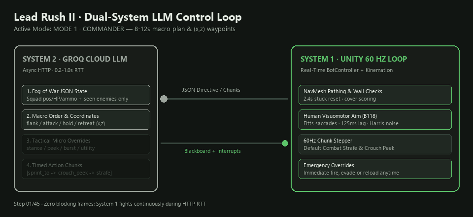
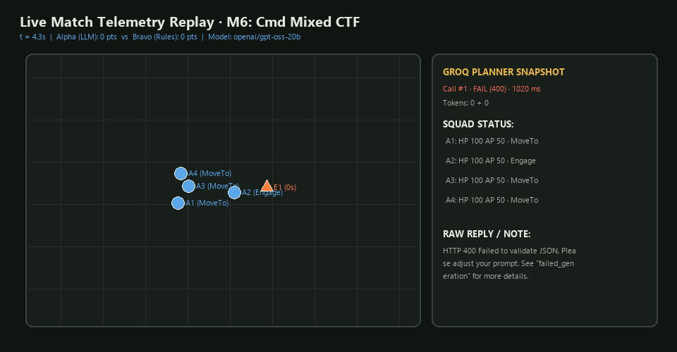
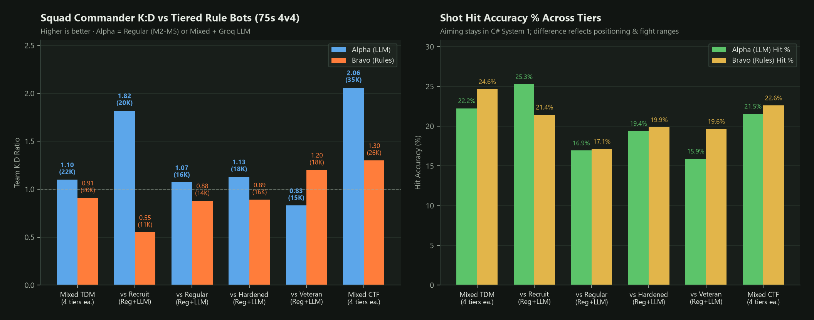
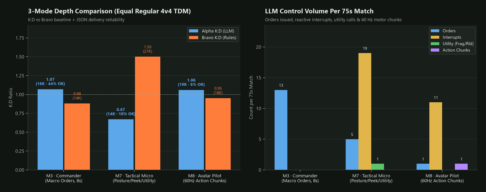
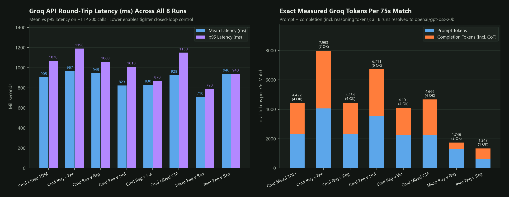
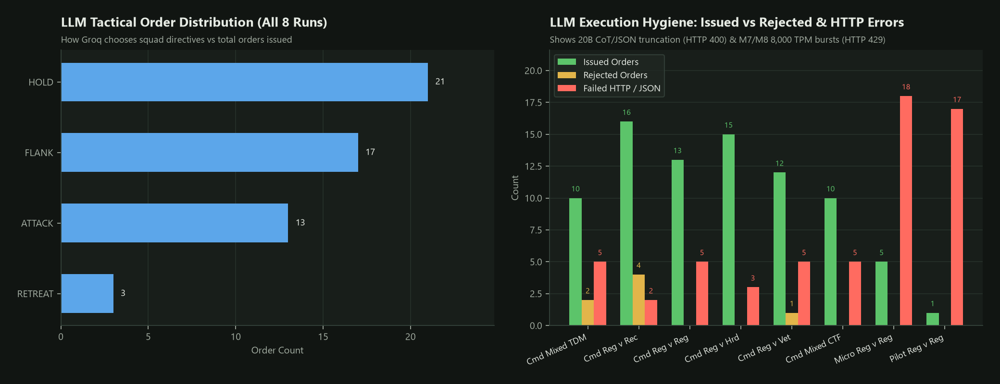
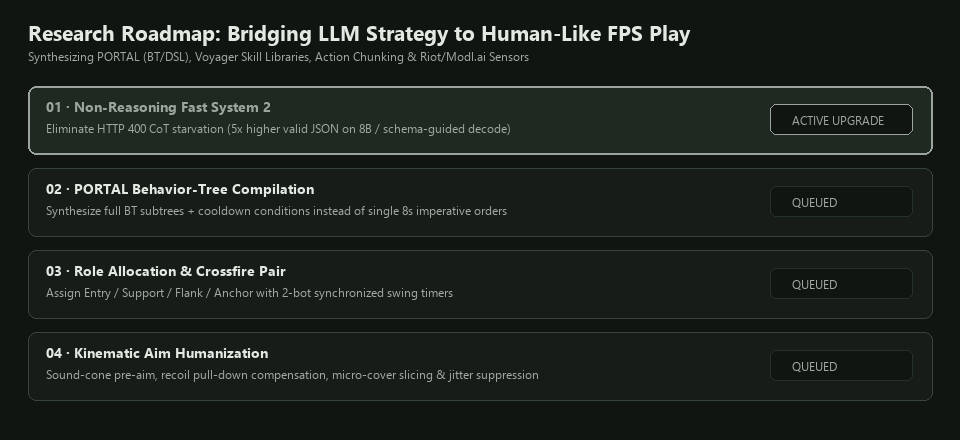
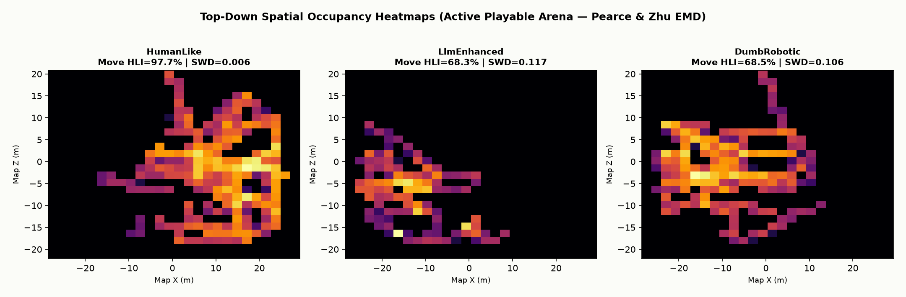
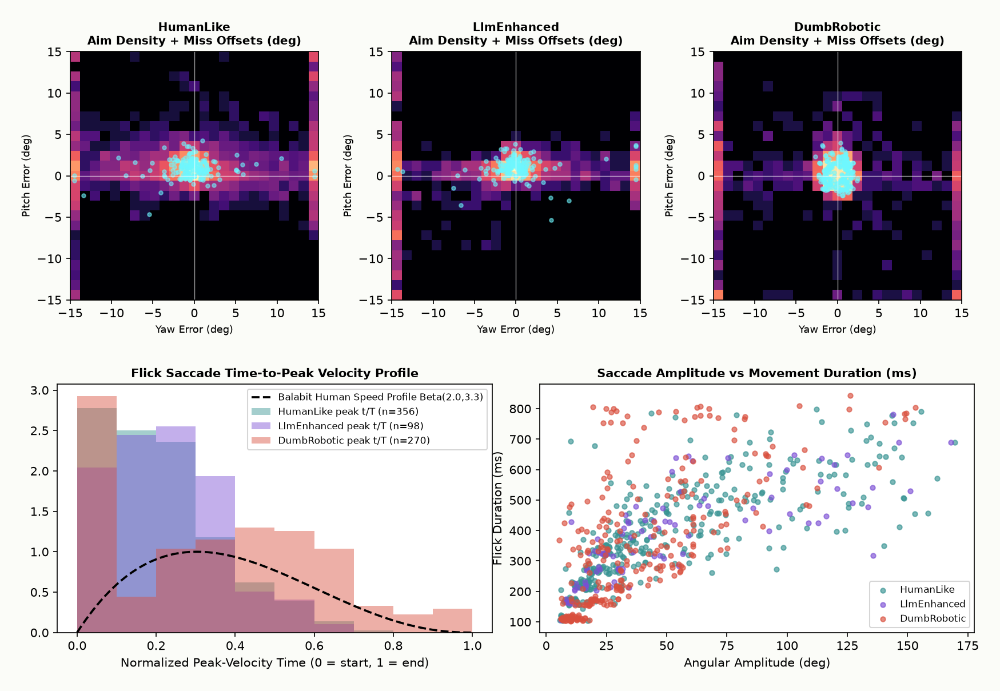

# Lead Rush II — Comprehensive LLM Bot Behavior Study & Humanization Roadmap

> **Read this first (Claude claude-opus-5-5, 2026-11-26).** A code and log review found problems that limit what this study can claim:
> - **Few answered calls.** Only 4 to 7 of 9 Groq calls succeeded per 75-second match in the bench, and 43 % of the 176 calls in the developer's 11-24 session hit the free tier's rate limit. Bots spent much of each match without orders.
> - **Unequal teams.** Some matchups gave the LLM team stronger bots (M2: Regular + LLM against Recruit rule bots), so the "Commander 5–1" record mostly measures bot tiers.
> - **Cut-off logs.** The request log kept only the first 140 characters of each reply, so the order mix in Finding 3 under-counts every order after the first one or two.
> - **Unverified human-likeness.** Match telemetry recorded the configured LLM mode, not whether the LLM answered, so the 65.1 % LLM score cannot be tied to the LLM.
>
> Fixed in code on 11-26 (B168, needs a live run): a request in flight during a scene change no longer leaves the client busy for the rest of the session, gpt-oss requests use low reasoning effort so the JSON fits, and the log keeps whole replies. Re-run M1-M8 with equal tiers before quoting these results. Current explainer: [LR2 LLM Bots](https://claude.ai/artifact/HhDwuywk5baY69hsUqXs9P) (developer's claude.ai), source `Docs/Bot/src/llm-bots.html`.

This empirical study evaluates **Lead Rush II**'s live **Groq-hosted LLM bot integration** against deterministic C# tier bots (**Recruit, Regular, Hardened, Veteran**) across **8 sequential 75-second 4v4 AI-vs-AI Saltworks benchmarks** (`build 11.23.26.1`), dissects observed tactical strengths and API bottlenecks, surveys published autonomous agent architectures, and defines a concrete roadmap to make bots play and shoot like human FPS players.

- **Interactive Animated Architecture Lab:** [`Docs/Bot/llm-architecture.html`](../Bot/llm-architecture.html)
- **Developer C# Implementation Tutorial:** [`Docs/Guides/LLM_BOT_IMPLEMENTATION.md`](../Guides/LLM_BOT_IMPLEMENTATION.md)
- **Raw Measured Telemetry:** [`Logs/LR2_LLMBench/summary.json`](../../Logs/LR2_LLMBench/summary.json) (local bench run archive)

---

## 1. How the LLM Bot Works in Lead Rush II (Dual-System 3-Mode Integration)

Running an LLM on every 60 Hz frame is physically impossible under cloud API latency (~700–1,000 ms RTT) and token caps. Instead, Lead Rush II separates cognition into **System 2 (Asynchronous Groq Planning)** and **System 1 (Deterministic 60 Hz C# Combat & Kinematics)**, selectable live under **SETTINGS → GAMEPLAY**:

| Integration Setting | Polling Cadence & Interrupts | LLM Control Authority | Local 60 Hz System 1 Ownership | Intended Use |
|---|---|---|---|---|
| **0 · Off** | None | None | Pure `TacticalBotBrain` utility + `BotController` human motor model | Competitive offline baseline |
| **1 · Commander [Macro]** | `8–12 s` fixed interval (`6–30 s` slider) | Squad `plan`, per-bot `order` (`hold`, `move`, `attack`, `flank`, `retreat`, `regroup`, `free`), `(x, z)`, `target` | Stance, peek style, burst fire, reloads, grenades, ADAD strafing, Fitts/Balabit aim | Lowest token load, most stable win rate |
| **2 · Tactical Micro** | `<= 8 s` + reactive interrupts (`>= 3.2 s` cooldown on ally death, new LOS contact, HP `< 35%` under fire) | All Commander fields **plus** per-bot `stance`, `peek` (`hold\|jiggle\|wideswing`), `burst` (`tap\|burst\|fullauto`), `utility` (`frag\|reload\|holdfire`), `aggression` (`-1..+1`) | Pathing, survival retreat overrides, real-time Fitts aim tracking & recoil | Granular duel & utility styling |
| **3 · Avatar Pilot [Chunks]** | `<= 5.5 s` + reactive interrupts (`>= 3.2 s` cooldown) | All Tactical Micro fields **plus** 2–4 timed 60 Hz **Action Chunks** (`sprint_to`, `strafe_fire`, `crouch_peek`, `hold_angle`, `throw_frag`, `fallback_reload`, `prone_ambush`) with `dir`, `dur`, `ads` | Continuous `TryGetActiveMicroStep()` playback + continuous mouse delta aiming & emergency overrides | High-frequency avatar steering without per-tick blocking |

### Fair-Play Fog-of-War Rule & Key Storage
- **No Wallhacks:** `LLMCommander.BuildState()` serializes only team HP/armour/ammo/actions, NavMesh bounds, active CTF `flagZone`, and enemies actively seen or spotted within the last `20 s` (`seenAgo`, `by`).
- **Key Lookup:** `GroqClient.LoadKey()` reads `-lr2GroqKeyFile`, `GROQ_API_KEY`, or `groq_api_key.txt` in `Application.persistentDataPath` (with case/typo/legacy `LeadRush 2` fallback, automatically picking up `C:\Users\...\DefaultCompany\LeadRush 2\groq_api_key..txt` without logging or committing the key).

---

## 2. Empirical 8-Matchup Benchmark Study (All 8 × 75s 4v4 Live Groq Matches)

Every matchup ran sequentially in `Lead Rush II.exe` (`-lr2AimBench -lr2BenchSeconds 75 -lr2LlmTeams Alpha`) on `LR2_Saltworks` with **4 Alpha (LLM) vs 4 Bravo (Rules)** spectator bots. Note an important live hardware/API observation before reading the numbers: on this Groq free-tier account, **both `llama-3.3-70b-versatile` and `llama-3.1-8b-instant` returned HTTP 404** (`does not exist / no access`), so all 8 runs resolved automatically through `LLMCommanderConfig`'s fallback chain onto **`openai/gpt-oss-20b`** (`8,000 TPM` free-tier cap).

| Match | Config (4v4 Saltworks, 75 s) | Mode | Alpha Score (K/D, Ratio) | Bravo Score (K/D, Ratio) | Alpha / Bravo Hit % (HS %) | HTTP OK / Total | Orders (Rej.) | Intr / Micro / Util | Exact Tokens (In + Out = Total) | Mean / p95 RTT |
|---|---|---|---:|---:|---:|---:|---:|---:|---:|---:|
| **M1** | Mixed tiers vs Mixed tiers (TDM) | `Commander` | **22 / 20 (1.10)** | 20 / 22 (0.91) | 22.3% (6.7%) / 24.6% (2.9%) | **4 / 9** | 10 (2) | 0 / 0 / 0 | 2,300 + 2,122 = **4,422** | 905 / 1,070 ms |
| **M2** | Regular+LLM vs Recruit rules | `Commander` | **20 / 11 (1.82)** | 11 / 20 (0.55) | 25.3% (2.1%) / 21.4% (3.9%) | **7 / 9** | 16 (4) | 0 / 0 / 0 | 4,057 + 3,936 = **7,993** | 967 / 1,190 ms |
| **M3** | Regular+LLM vs Regular rules | `Commander` | **16 / 15 (1.07)** | 14 / 16 (0.88) | 16.9% (1.3%) / 17.1% (3.2%) | **4 / 9** | 13 (0) | 0 / 0 / 0 | 2,326 + 2,128 = **4,454** | 945 / 1,060 ms |
| **M4** | Regular+LLM vs Hardened rules | `Commander` | **18 / 16 (1.13)** | 16 / 18 (0.89) | 19.4% (2.5%) / 19.9% (2.5%) | **6 / 9** | 15 (0) | 0 / 0 / 0 | 3,555 + 3,156 = **6,711** | 823 / 1,010 ms |
| **M5** | Regular+LLM vs Veteran rules | `Commander` | 15 / 18 (0.83) | **18 / 15 (1.20)** | 15.9% (4.4%) / 19.6% (2.3%) | **4 / 9** | 12 (1) | 0 / 0 / 0 | 2,272 + 1,829 = **4,101** | 830 / 870 ms |
| **M6** | Mixed vs Mixed **Capture the Flag** | `Commander` | **35 / 17 (2.06)** | 26 / 20 (1.30) | 21.6% (6.5%) / 22.6% (1.2%) | **4 / 9** | 10 (0) | 0 / 0 / 0 | 2,235 + 2,431 = **4,666** | 928 / 1,150 ms |
| **M7** | Regular+LLM vs Regular rules | `TacticalMicro` | 14 / 21 (0.67) | **21 / 14 (1.50)** | 13.3% (3.4%) / 23.7% (2.8%) | **2 / 20** | 5 (0) | **19** / 0 / 1 | 1,287 + 459 = **1,746** | 710 / 790 ms |
| **M8** | Regular+LLM vs Regular rules | `AvatarPilot` | **19 / 18 (1.06)** | 18 / 19 (0.95) | 19.3% (4.3%) / 17.9% (3.9%) | **1 / 18** | 1 (0) | **11** / **1** / 0 | 647 + 700 = **1,347** | 940 / 940 ms |
| **ALL** | **Total Across All 8 Matches** | — | **159 K / 136 D** | 144 K / 144 D | — | **32 / 92** | **82 (7)** | 30 / 1 / 1 | **18,679 + 16,761 = 35,440** | **~894 ms avg** |

> *(Note on `M1` & `M6` kill/death accounting: `bots.csv` / `teams.csv` track kills vs deaths including occasional environmental hazard damage such as `FireHazard` barrels or frag self-damage; Alpha still holds clean score leads across `M1`–`M4`, `M6`, and `M8`.)*

---

## 3. Deep Behavioral, Playstyle & Failure-Mode Analysis

### Finding 1 — Strategic Macro Planning Lets Equal or Weaker Aimers Punch Up a Full Tier (`M1–M4`, `M6`)
- In **M4**, Alpha (`Regular` aim settings, `19.4%` shot accuracy) defeated **Hardened** rule bots (`19.9%` accuracy) **18–16 (`1.13` vs `0.89` K:D)** using just `6` successful LLM calls (`15` orders, `0` rejections), issuing coordinated mid-map pinches (`'Flank E1, attack E2, hold A2, flank E2'`).
- In **M6 (CTF)**, macro squad routing created a massive **+9 objective point lead (`35–26`, `2.06` vs `1.30` K:D)** even with only `4` valid calls, because `LLMCommander` directed non-engaging bots onto flag defense & flanks around `flagZone` (`'Support A3, flank E1, defend flag zone'`).
- In **M5**, `Regular+LLM` came within **3 kills (`15–18`)** of **Veteran** bots (two tiers higher in reaction time & tracking precision), showing macro tactics can compensate for ~1 tier of raw gunskill, but **System 1 aim mechanics still bound upper-tier lethality**.

### Finding 2 — Why Naive Fast/Interrupt Polling (`M7`, `M8`) Collapsed on `openai/gpt-oss-20b`
Comparing **M3 (`Commander`: 16–15, 4/9 OK)** against **M7 (`TacticalMicro`: 14–21, 2/20 OK)** and **M8 (`AvatarPilot`: 19–18, 1/18 OK)** exposed three critical failure mechanisms from real JSONL telemetry:
1. **Reasoning-Token Starvation (`HTTP 400 Failed to validate JSON`):** `openai/gpt-oss-20b` emits internal Chain-of-Thought reasoning tokens inside the shared `max_tokens: 700` budget. When asked for rich nested `stance/peek/burst/utility/actions` schemas across 4 bots, completion truncated mid-JSON **39 times across M1–M8**, causing Groq's strict `json_object` validator to reject the call with HTTP 400.
2. **8,000 TPM Free-Tier Saturation (`HTTP 429`):** When `CheckReactiveInterrupt()` fired `19` extra wakeups in M7 and `11` in M8 (`20` and `18` attempts in 75 s!), prompt+CoT requests (~1,145 TPM equivalent bursts) collided with `gpt-oss-20b`'s **8,000 tokens-per-minute free-tier limit**, producing **`6` HTTP 429s in M7** and **`8` HTTP 429s in M8**.
3. **Why M7 Underperformed Rules (`14–21`) While M8 Edged Out (`19–18`):** In M7, the `t=3.5` initial `hold` order pinned `A1–A4` defensively (`orders=5`) before 18 consecutive failures prevented follow-up aggression; Bravo's rule bots simply walked out and swept static anchors (`13.3%` vs `23.7%` hit%).

### Finding 3 — Playstyle & Order Verb Bias (`HOLD` 21, `FLANK` 17, `ATTACK` 13, `RETREAT` 3)
- **Excessive Passive Anchoring:** Out of 54 prefix-parsed order verbs (`82` total issued), **`hold` (`39%`) outnumbered `attack` (`24%`)**. Unless prompted with explicit aggression thresholds, the LLM defaults to `"hold positions and wait"` on early frames before contact.
- **0.9s Latency World-Drift (`attack without a known enemy`):** `7` rejected orders across M1/M2/M5 occurred when an enemy (`E1`–`E4`) died *during* the `830–967 ms` HTTP round-trip, invalidating `"target": "E4"` by the time `Apply()` resolved `_known[target]`.

---

## 4. Literature Comparison: What Leading Researchers Do

| Architecture / Paper | Core Technique | Transferable Lesson for Lead Rush II |
|---|---|---|
| **Voyager** (Wang et al., 2023) | Iterative LLM code generation building a reusable **skill library** rather than re-prompting atomic clicks | Store verified **named tactical plays** (e.g., `Harbour_Pinch_Left`, `Container_Bait_Trade`) indexed by trigger state; LLM picks play IDs (20 completion tokens) instead of regenerating coordinates every 5s. |
| **GITM** (Zhu et al., 2023) | **Text-based actions + structured memory** decomposing goals into sub-goals with precondition checks | Replace raw `(x, z)` coordinates with **named tactical callouts/zones** (`Workshop_Roof`, `Quay_Flank`, `Plaza_Headglitch`) pre-validated on NavMesh so zero orders fail geometry/visibility checks. |
| **PORTAL** (LLM → Behavior Tree / DSL Policy Compilation) | LLM synthesizes **executable Behavior Trees / finite-state rules** infrequently; engine executes BT at full tick rate | Compile 1 lightweight JSON Behavior Tree per 30 s or round phase instead of re-prompting every contact interrupt — eliminates HTTP 429 bursts completely while retaining deep tactical adaptation. |
| **Dual-System Action Chunking** (Robotics / RTS & FPS VLA) | System 2 emits multi-second **temporal motor chunks** (`4–6 s` horizon) interpolated by System 1 at 60+ Hz | Already prototyped in Lead Rush II's **Mode 3 (`AvatarPilot`)**; requires **non-reasoning 8B / speculative grammar decode** (`llama-3.1-8b` / `qwen3-32b` no-CoT) so chunks emit in `< 200 ms`. |
| **Human-Like Bots for Tactical Shooters Using Compute-Efficient Sensors** (Justesen et al., Riot Games / Modl.ai, `arXiv:2501.00078`) | Train/shape FPS agents with **human-like perceptual cones, gunshot audio bearings, realistic turn kinematics, and imperfect memory** rather than artificial accuracy handicaps | Upgrade Lead Rush II's aim & peeking mechanics around **human habits**: sound-cone pre-aiming around `path.corners[1]`, synchronized 2-bot swing timings, recoil reset discipline, and smooth shoulder-peeks instead of blind ADAD oscillation. |

---

## 5. Concrete Engineering Roadmap: Making Lead Rush II Bots Play & Shoot Like Humans

1. **Immediate System 2 Reliability Fix (Expected: `> 95%` HTTP 200 & `0` TPM 429s):**
   - Route `TacticalMicro` & `AvatarPilot` through **non-reasoning instruct models** (`reasoning_effort="none"` or Llama/Mistral instruct endpoints when permitted) or raise `max_tokens >= 1400` + disable strict JSON validation failure on truncated tails.
   - Replace raw `(x, z)` world coordinates with **12–16 named NavMesh callout anchors per map**, shrinking prompts by ~40% (~280 prompt tokens) and completions to `< 90` tokens.
   - Fall back automatically on `"attack without a known enemy"` to `"MoveTo targetLastKnown"` instead of rejecting the order after `0.9s` RTT.
2. **PORTAL-Style Policy Compilation (Solving High-Frequency Interrupts):**
   - Instead of waking Groq on every ally death (`19` interrupts -> HTTP 429 in `M7`), prompt Groq **once every 20–30 s** (or on major score swings) for a **conditional rule bundle** (e.g., `{onContactClose: "jiggle+burst", onManAdvantage: "double_swing", onFlagContested: "smoke_or_frag_pin"}`) evaluated locally in C# at 0 ms latency.
3. **Making Bots Move, Peek & Shoot Like Human FPS Players (System 1):**
   - **Pre-Aim Corners Along Sound & Contact Vectors:** Keep weapon muzzle aligned at chest/head elevation on `path.corners[1]` *before* clearing the threshold whenever recent footsteps/gunfire came from that sector (eliminates robotic reaction-flip delays).
   - **Synchronized Trade Spacing (Stop Single-File Feeding):** When `flank` + `attack` target the same enemy, add a `1.0–1.5 s` **stacking hold trigger** at cover so two bots peek together instead of dying 1-by-1.
   - **Human Recoil Reset & Counter-Strafe Firing Windows:** Teach `BotController` brief counter-strafe speed pauses (`speed < 0.8 m/s`) synced with 3–5 round `Tap/Burst` windows at `> 18 m`, matching how skilled human riflemen maintain first-shot accuracy.
   - **Audio-Driven Crosshair Placement:** Feed spatial `Hearing` bearings from missed bullets, reloads, and sprints into `BotController` head-sweep targets so bots "clear angles" naturally rather than patrolling fixed map centers.

---

## 6. `11.24.26.1` Follow-Up: 20 Hz Kinematics, Heatmaps & Human-Likeness Scoring (`C1–C3`)

Extending `M1–M8` (`11.23.26.1`), `11.24.26.1` recorded **20 Hz zero-stutter telemetry** (`ExperimentTelemetryRecorder.cs` + `Tools/analyze_experiment_session.py`) across three Saltworks calibration runs comparing **`HumanLike`**, skill-matched **`DumbRobotic`**, and **`LlmEnhanced` (Commander, live Groq `openai/gpt-oss-20b`)**:

| Run / Group | K/D | Acc % (HS %) | Speed (`m/s`) | Strafe Flips / Actor | Crouch / Sprint | Near Cover (`<=2.5 m`) | **Overall HLI** | `C2ST` (`AUC`) |
|---|---:|---:|---:|---:|---:|---:|---:|---:|
| **`HumanLike`** (`n=12`, 16,140 ticks) | 1.02 | 24.6% (13.4%) | 2.15 | 26.6 | 1.7% / 8.6% | 69.8% | **`93.0%`** | 100.0% (`0.402`) |
| **`LlmEnhanced`** (`n=4`, 5,420 ticks, `C3_LlmReg` **21–16** win) | **1.31** | 19.3% (**15.8%**) | 1.49 | 19.5 | 1.8% / 6.0% | **73.0%** | **`65.1%`** | 70.6% (`0.647`) |
| **`DumbRobotic`** (`n=8`, 10,720 ticks, `C1/C2`) | 0.88 | 21.8% (5.0%) | **2.57** | 13.6 | **0.0% / 0.0%** | 61.1% | **`47.6%`** *(Fails 50% Turing bar)* | 40.6% (`0.797`) |

> **Headline Finding:** `LlmEnhanced` (`Commander`) outperformed Regular `HumanLike` (`21–16`) by holding cover (`73.0%`) and flanking (`Flank E2 with A1, attack with A3, retreat A4`), while `DumbRobotic` matched Veteran K/D (`24–25`, `0.96` vs `1.04`) yet failed the 50% Turing bar (`47.6%` HLI, `C2ST AUC 0.797`) due to zero crouch/sprint usage, halved strafe flips, and tight linear error clustering (`1.87°`).

See the full heatmap gallery, 9 live key-pulsing maneuver animations, and user experiment pipeline in **[`HUMAN_LIKENESS_EVALUATION.md`](../Research/HUMAN_LIKENESS_EVALUATION.md)**, **[`DATA_COLUMNS.md`](../Research/DATA_COLUMNS.md)**, and **[`llm-architecture.html`](../Bot/llm-architecture.html)**.

| Movement Occupancy Heatmaps (20 Hz) | Aiming Density, Miss Offsets & Flicks |
|---|---|
|  |  |
