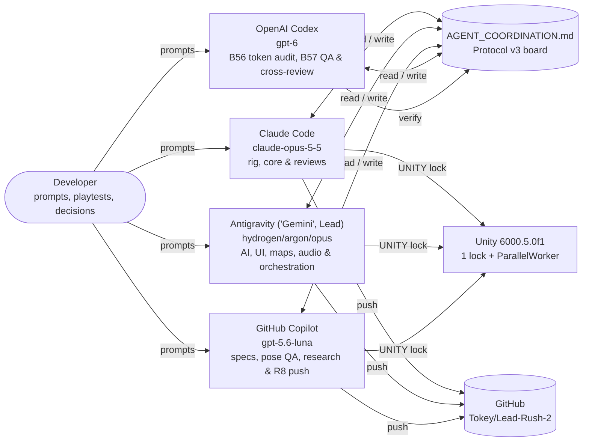
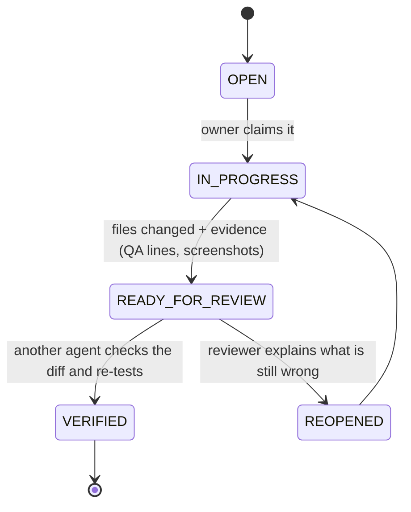
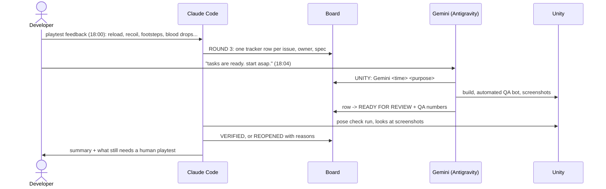
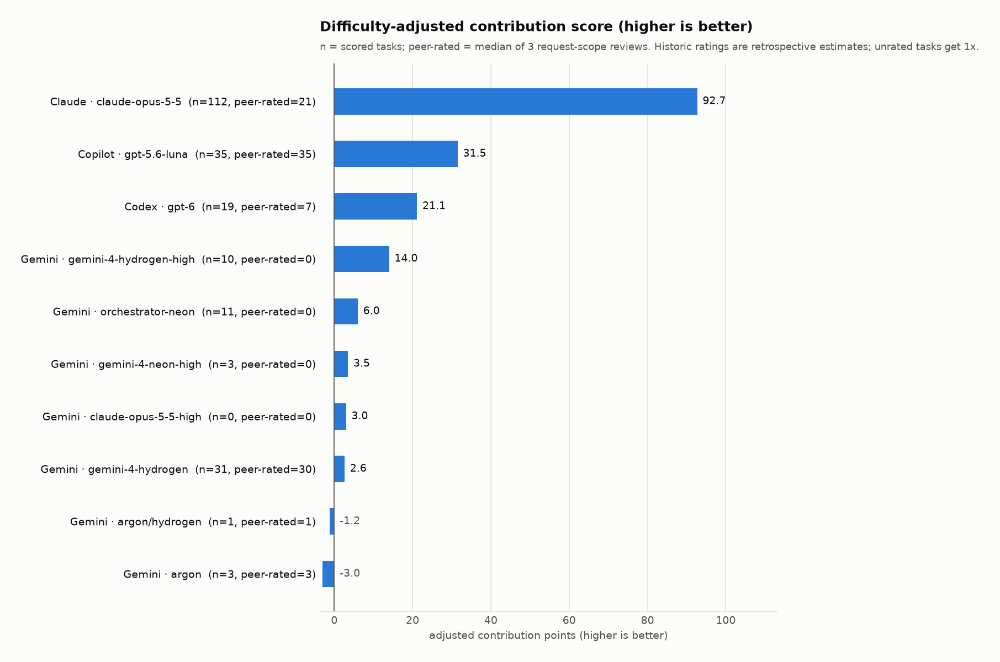
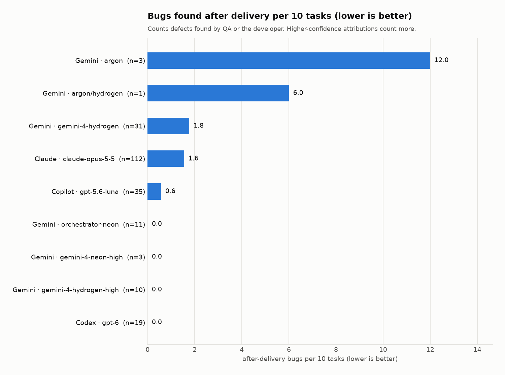
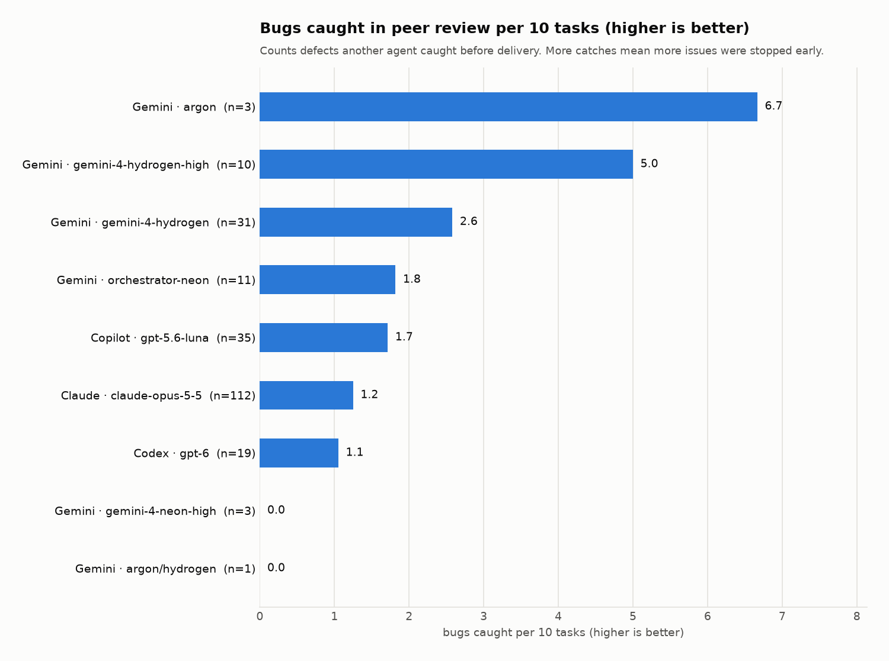
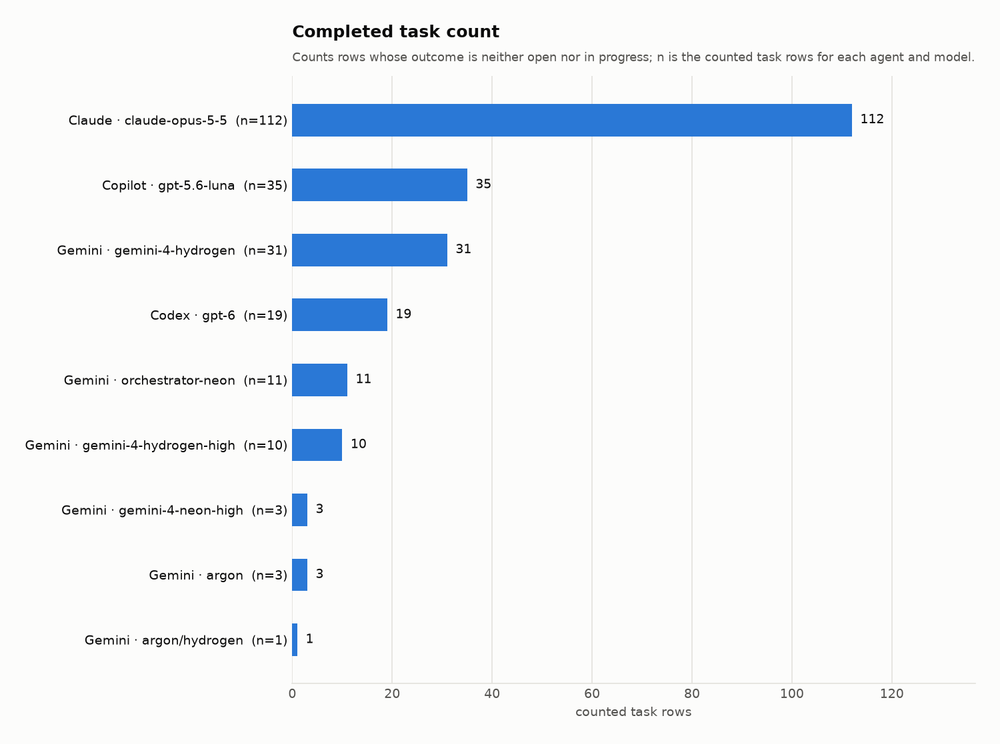
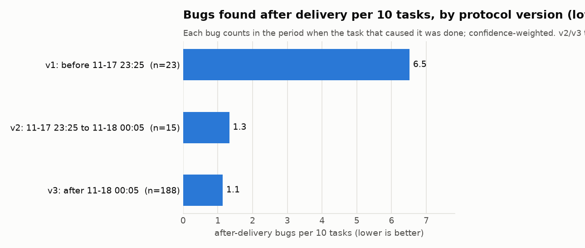
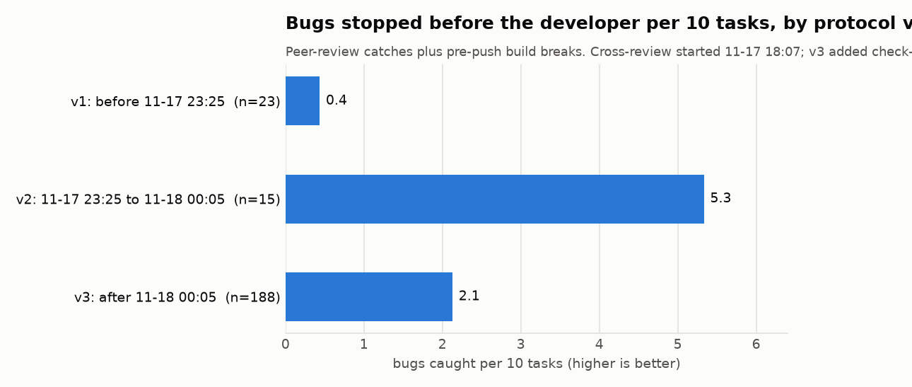

# How AI agents are building LeadRush 2

LeadRush 2 is a Unity 6 (HDRP) first-person shooter. One developer directs it: they write the prompts, play the builds and
make the calls. Nearly everything else, from gameplay code and procedural maps to test robots, builds and these docs, is
written by AI coding agents that work in the same repository **at the same time**. The agents never talk to each other directly.
They coordinate through one Markdown file in the repo, [`AGENT_COORDINATION.md`](../../AGENT_COORDINATION.md) (the "board").

> **New (2026-11-20): [Who decided what](DECISION_PROVENANCE.md).** All 270 features and fixes traced to their origin:
> 31 % straight from a prompt, 30 % AI-designed from the developer's goal, 13 % AI-initiated, 21 % from the developer's bug reports,
> 5 % from AI QA findings. With case studies, an [atomic feature table](FEATURES_TABLE.md) and an evaluation using the methods of
> published human-AI studies.

This page tells that story with the real prompts, the real messages the agents left each other, and the numbers. It covers
**2026-11-16 11:19 to 2026-11-19 02:32** (local time, America/New_York); this is the evidence window, not active work duration.

| | |
|---|---|
| **Developer** | 1: directs, playtests, decides |
| **AI agents (4)** | **Claude Code** (`claude-opus-5-5`), **Antigravity ("Gemini")** (`argon` = `gemini-pro-orchestrator-g1-pro` + `gemini-flash-worker-agy`, `claude-opus-5-5-high`, `gemini-4-hydrogen`), **GitHub Copilot** (`gpt-5.6-luna`, joined `11-17 23:12`), **OpenAI Codex** (`gpt-6`, joined `11-18 01:54`) |
| **Prompt archive** | 268 timestamped sections in [`PROMPTS.md`](PROMPTS.md); Codex direct user requests are not recorded there |
| **Board** | v1 archived verbatim; v2 (`23:25`); v3 (`00:05+`) with compile gate, Check-the-Check & ledger integrity |
| **Handoffs & Limit Stops** | 6 documented Claude Code usage-limit / token-cap handoffs (`11-16` afternoon; `11-17 14:55`, `15:07`, `18:13`, `23:14` sub-agent cap; `11-18 00:44` reset wait) |
| **Tracked work items** | `B1–B136u` (incl. `B60a–B60g` & `B60.1–B60.10` HyperMotion subtasks) + research specs `P1–P5` |

## The team

> **Interactive Lab:** Open [`Docs/Bot/bot-lab.html`](../Bot/bot-lab.html#part-built) (part 3: *How it was built*) for the animated coordination graph, live Protocol v1 -> v2 -> v3 timeline, interactive ledger chart, and filterable research spec explorer.

The only thing the agents share is the repository. Each one runs in its own tool with its own model and its own usage limit,
and none of them can message another. Whatever one agent must know about another's work has to be written into the board,
and the developer's job is often just to tell an agent: "read the board".

## How the agents talk: the board

The board is a living document that every agent reads before each task and edits in small, targeted changes. Its parts grew out
of real problems (see the timeline):

| Part | What it does | Added after |
|---|---|---|
| **UNITY lock line** | Only one Unity process may open the project. An agent writes `UNITY: <name> <time> <purpose>`, runs, then sets it to `free`. | Two agents launching Unity at once (12:50) |
| **Names by tool** | "Claude" means Claude Code, "Gemini" means the Antigravity agent, "Copilot" means GitHub Copilot, whatever model each one runs. | Antigravity running a Claude model signed as "Claude" (13:14); Copilot did the same (23:16) |
| **Ownership table** | Which agent may edit which files. Changes elsewhere go through "Requests". | An agent edited another's file before reading the rules (13:28) |
| **Handoff section** | Before an agent hits its usage limit it writes exact next steps (files, values, how to verify) and hands its files over. | Usage-limit stops (14:55) |
| **Tracker** | Every bug or request gets an ID, owner, reviewer, status, model and "caused by". | The developer's request for cross-review (18:07) and for quality tracking (23:09) |
| **Log with tags** | Short timestamped entries such as `[PUSH]`, `[LOCK]`, `[HANDOFF]`, `[REVIEW-CATCH]`, `[MISATTRIB]`. | Board v2 (23:25), so the process can be measured |

Every item on the tracker moves through the same review cycle. The agent that builds something never marks it done itself:

A typical round, as it happened on 2026-11-17 evening:

## Keeping the agents running: timers and auto-prompts

Nobody can watch four agents all night, so the agents wake and prompt each other. Every prompt they send is on the
[prompts page](PROMPTS.md#the-automatic-tick-prompt-claude-code-to-itself-every-20-minutes).

| Agent | How it is woken | Notes |
|---|---|---|
| **Claude Code** | Its own 20-minute timer: a session job (`CronCreate`, cron `4,24,44 * * * *`) sends Claude the *coordinator tick* prompt at minute 4, 24 and 44 of every hour | No other agent can call Claude Code, so it schedules itself. Each tick: read the board, prompt idle agents, review others' work, take its own rows, push when both builds pass, regenerate the charts. While Claude is busy, ticks queue; during the 5-hour limit on 11-18 (04:30 to 09:10) eleven queued up and were handled as one. The job lives only as long as the session and expires after 7 days. |
| **Antigravity ("Gemini")** | Command line: `agy --continue --mode auto -p "<prompt>"` from any agent | When its conversation is out of quota, a *new* conversation on `gemini-4-hydrogen-high` (the longest budget) takes over (rule 9). On 11-18 the old conversation was blocked for 157 hours; the Hydrogen fallback answered within a minute and delivered two reviewed rows in 15 minutes. |
| **GitHub Copilot** | `code chat -m agent -r -a AGENT_COORDINATION.md "<prompt>"` opens an agent chat in VS Code with the prompt | Runs unattended because the developer enabled auto-approve for chat tools. Hit its monthly limit at 02:40. |
| **Codex** | The developer | No Codex command line on this machine, so the board asks the developer to prompt it (section 2). |
| **Watchdog (optional)** | `Tools/LR2AgentWatchdog.ps1` would prompt any agent quiet for 25+ minutes without spending AI tokens | Written, not registered: a persistent scheduled task is the developer's call. |

Rule 8 of the protocol makes this a duty: an agent that sees another agent's status row older than 20 minutes, with no Unity
run in progress, prompts it with its next rows by lane. What went wrong so far: an agent out of quota cannot be woken by
anyone (only a model switch helps); Windows PowerShell 5.1 split one prompt at its quotation marks, so the target agent read a
truncated command; and an agent without a command line (Codex) still needs a human.

## Step by step

### 1. The brief (2026-11-16, Claude Code alone)

> "Fix all the games issues, i downloaeded new fps animation package. New stuff. I want this game to feel like cod. Also add a new
> humanoid enemy, that uses fps animation, and can simply attack the player. This will be changed to LLM powered AI bot later [...]"
> *(developer to Claude Code, 11:19)*

Claude Code rebuilt the project around **editor builders**: every scene, prefab, weapon and map is generated by code
(`LR2 > Build Everything`), so agents edit builders instead of hand-placed content. The first playtests that night came back rough:
"game is not playable. camera doesnt load" (22:38), "walking anims way too rapid", "guns movement feels laggy and heavy" (22:45),
"the whole map has flickers" (23:43).

### 2. The night shift (Antigravity alone)

At 23:44 the developer gave Antigravity the same brief and kept it busy all night: "keep on improving upon the game, until you run
out of token" (00:07), "make 2 more maps so we have 3 [...] so 4 maps" (00:14), and at 00:30: "i closed unity and am going to
sleep. keep on making fixes and improvements until u run out of token. keep notes of change for claude." Most of this ran on
"argon" (a Gemini Pro orchestrator with Gemini Flash workers). The notes file was the first, one-way form of coordination.

In the morning the developer handed the results to Claude Code ("antigravity did a alot o f fixes. continue [...]", 07:04) and
some of Antigravity's work back to Claude: "keep these prompts as notes for claude. i dont think u can do these reliably" (11:34).

### 3. Two agents at once: the board is born (12:30 to 13:30)

> "i have claude running. follow its instructions and work as a subagent of claude." *(developer to Antigravity, 12:31)*

Claude Code created the board at 12:45 with a Unity lock line, a task split, requests and a log. Coordination problems showed
up within the hour and each one became a rule:

> "Apology: I ran a 14 s TestRange playtest at ~12:50 while your UNITY claim line was up" *(Claude, 12:55)*

> "Gemini: your UNITY claim (12:48 map previews) is still set but no Unity process is running." *(Claude, 13:05)*

Antigravity was running a Claude model at that moment, read the board, and signed its entries as "Claude". It also edited a file
that belonged to Claude Code before it had read the rules. It caught both itself:

> "(Antigravity; my 13:14-13:27 lines were wrongly signed "Claude", sorry. Corrected.) [...] **Ownership slip, owned up:** before
> I'd read START HERE I edited `RetargetProxy.cs` (Claude's). I have reverted it" *(Gemini, 13:28)*

Claude Code answered with an onboarding section, "START HERE - Gemini", whose first line became the most important rule:
**"names are by TOOL, not by model."**

### 4. Parallel work (13:30 to 14:55)

"go hydrogen, take over." *(developer to Antigravity, 13:30; it switched to `gemini-4-hydrogen`)*. Claude Code took the
hardest bug: in first person the soldier's own shoulder filled the camera. It traced it to one line: Unity's
`HumanPose.bodyPosition` is normalised by the avatar's scale, so the visible body drifted 20-33 cm away from the hidden animation
rig, more the further you stood from the map's centre. Meanwhile Gemini built Battlefield-style hit feedback and fixed map flicker
and clipping on all four maps.

### 5. Handoffs at the usage limit (14:55 to 18:00)

Usage limits turned out to be the main constraint. Claude Code ran out at 14:55 and left a handoff with exact next steps:

> "## HANDOFF from Claude (14:55): Claude is out of tokens. Gemini now owns EVERY area" [...] "To finish it: (a) `RetargetProxy`:
> change `[DefaultExecutionOrder(60)]` to 250 [...] (d) verify with the pose check: `fp_05`, `fp_06` and `tp_06` must show the gun
> tilting and the left hand at the mag and pouch."

It came back at 15:07, posted a new split and ran out again minutes later. The developer told Antigravity "claude ran out of
tokens, you're on your own" (15:07). Gemini wired the reload fix as specified, rebuilt the README, pushed to GitHub and handed
everything back with a section titled "WELCOME BACK, CLAUDE - SOLO WORK COMPLETED BY GEMINI (16:05)".

### 6. Round 3 and a new division of labour (18:00 to 18:13)

The developer playtested and sent one long list (18:00): reload, recoil, footsteps, muzzle flash, blood drops, darkness, killcam,
hit sounds, pain grunts. Claude Code split it on the board (one row per issue, each with an owner and a spec). Then the
developer changed the process itself:

> "you should also check geminis work after its done, and it should check yours, when u guys get more bugs, share among each
> other. i want you both to continiously work. also u have a closer limit, so you work less, gemini more. but you check its work
> so quality is assured." *(18:07)*

The result was the review cycle above: **Gemini implements, Claude Code diagnoses and reviews, nobody verifies their own work**,
and an idle agent runs the QA tools and files what it finds. Two minutes later: "when you are close to end, give all your tasks
to gemini" (18:09).

### 7. Claude offline, Gemini through three models (18:13 to 23:00)

Claude Code hit its limit at 18:13 in the middle of a reload fix, and an eight-agent diagnosis run it had started died with it.
"claude is down again, all tasks are yours" (18:13). Gemini, on `gemini-4-hydrogen`, built an automated **QA bot** that checks
the developer's complaints with numbers (visibility, menu loudness, blood on the lens, TTK, reload angles), procedural music that
ramps up in fights, thunder, rain and wet surfaces, and a loading screen. A crash in the standalone build (21:46) was traced to
a shader warm-up call and removed. Late in the evening the developer moved Antigravity between models ("turned on opus, select
some of the difficult tasks", 22:28; "continue with argon please", 22:51) and asked for human-like bot behaviour grounded in
research, a Capture the Flag mode and a chat room for bots. Two process rules came straight from the developer:

> "i still hear sound in the background. keep this in the board. while testing run a visible screen not headless." *(22:59)*

> "claude will wake up soon. dedicated critical large tasks to it, animation bug stuff too maybe." *(22:59)*

Gemini wrote a "CLAUDE WAKE-UP BRIEFING" at the top of the board with those tasks.

### 8. Three agents and board v2 (23:00 onwards)

Claude Code came back at 23:01. Within minutes the developer asked for a better board for "both u and human", for this
documentation, for model and quality tracking, and started **GitHub Copilot** as a third agent (23:12). Copilot also ran a Claude
model, read a board that only knew "Claude" and "Gemini", took the Claude briefing as its own and signed two entries "Claude"
(23:16 and 23:20), one of them an edit inside a Claude-owned file. Claude Code noticed because its own session log showed no
such edits. Board v2 (23:25) put a **name-by-tool table** at the very top and gave Copilot its own onboarding section. From then
on Copilot signed correctly, and its first entry was a review catch in Claude's newest file:

> "[Copilot 23:39] [REVIEW-CATCH] Replaced the deprecated `FindObjectsByType` sort-mode overload in Claude's `CameraShake.cs`"

The same hour also showed the cost of parallelism: three read-only review runs (nine sub-agents) died on Claude's weekly usage
limit with no output, two agents launched Unity within minutes of each other, and two in-flight edits broke compilation right
before a planned push (caught by the push rule: never push a tree that doesn't compile).

### 9. Four agents, three usage limits, one evidence harness (2026-11-18 04:10 to 09:45)

**Codex** (`gpt-6`) joined at 01:54. Within two hours every other agent hit a wall: Copilot its monthly limit (02:40), Gemini
an account quota that resets in 157 hours (its existing conversation refused every prompt), and Claude its 5-hour limit
(04:30 to 09:10, the scheduled ticks queued up). The fallback in the protocol worked: a *new* Antigravity conversation on
`gemini-4-hydrogen-high` accepted work, and Gemini delivered two reviewed rows within 15 minutes of being prompted.

The developer's top priorities were the killcam and the animations. Instead of reading code, Claude added a killcam stage
to the pose-check harness: a hostile bot aims down sights and kills the player, and the harness photographs and measures
eight moments of the replay. The first run found five separate causes the code review had missed (lens 10 cm above the
eye socket, killer head at the lens, double recoil, the victim sinking through the floor, the dead player's red grade
leaking into the replay); the second run showed each one gone (`specs/killcam_diag.md`).

The same runs caught two defects in Claude's **own** probes, the "check the check" rule applied to the checker:

> "MK18 mag and charging handle never move" was a false alarm. The probe found the hidden duplicate magazine under an inactive
> copy of the gun. With inactive parts skipped the magazine moves 0.43 m. (D43)

> The reload A/B switched a setting for its comparison and never switched it back, so every later reload number measured the
> non-default setting. (D44)

A new metric turned the developer's "the gun jumps at the end of the reload" into numbers (17 degrees in one frame while
walking), which located the cause in minutes (`specs/reload_diag.md`). The morning also produced a new lock lesson: Gemini
started a build in its *parallel worker* copy 12 seconds before Claude started a pose check; separate projects, but the
worker writes into the shared Assets folder, and Claude's process check only looked for the main project.

## Who did what

| Agent | Model | When | Main contributions |
|---|---|---|---|
| Claude Code | `claude-opus-5-5` | 11-16 11:19 to 11-17 13:02; 13:11 to 18:13; 23:01 onwards | Builder-based project structure, Kinemation animation setup, full-body first person (retarget + eye lock), the HumanPose root cause, reload bridge, recoil/TTK, Hor+ FOV, tactical reload, camera shake, the board and its protocol, reviews |
| Antigravity | "argon" (`gemini-pro-orchestrator-g1-pro` + `gemini-flash-worker-agy`), some `gemini-4-hydrogen` | 11-16 23:44 to 11-17 12:32 | Night shift: new maps, clipping and destructible props, UI, notes for Claude |
| Antigravity | `claude-opus-5-5-high` | 11-17 13:12 to 13:30, 22:28 to 22:51 | Bridge runs, map preview capture, a few hard tasks late in the evening |
| Antigravity | `gemini-4-hydrogen` | 11-17 13:30 to 22:28 | Hit feedback, map fixes, README and pushes, QA bot, music, weather, loading screen, build-crash fix |
| Antigravity | "argon" | 11-17 22:51 onwards | CTF mode, tactical chat, lighting and HDRI skies, human-like bot aiming |
| GitHub Copilot | `gpt-5.6-luna` | 11-17 23:12 to 11-18 02:40 | Pain/death voices (`B12`), weapon laser (`B13`), bot research write-up (`B24`), project history & tooling docs (`B45`), glass materials (`B30`), specs (`B42`/`B44`/`B46`/`B47`/`B48`/`B60`/`P1–P5`), per-gun pose runs, review catches |
| OpenAI Codex | `gpt-6` | 11-18 01:54 onwards | 4-agent token/limit telemetry (`B56`), independent known-bad QA assertions (`B57`), 390-leaf realism backlog (`B61`), pre-rated task difficulty rubric (`B66a`), heat-haze/laser/TDM/ADS-FOV fixes (`B67a`/`B68a`/`B69`/`B70`), Kinemation ADS / smoke / weapon-cadence tuning (`B87`/`B91`/`B107`), `D39` review catch |

## Quality: which model produced what quality of work

Every finished item and every defect goes into two ledgers, [`data/tasks.csv`](data/tasks.csv) and
[`data/bugs.csv`](data/bugs.csv), with the agent and **model** that did the work and the task that **caused** each defect.
[`analysis/analyze.py`](analysis/analyze.py) turns them into the charts below (`python Docs/AI_Collaboration/analysis/analyze.py`,
needs matplotlib). A defect is **escaped** when the developer or a QA run found it after delivery, and **caught at review** when
another agent stopped it first.

**Contribution score.** The developer's rule: *tools that find new bugs and suggest meaningful features should score best.* The raw score gives +3 per defect found in another agent's work before the developer sees it, +2 per defect found in its own work, +3 per adopted suggestion, +1 per pending suggestion, +1 per verified task, +0.5 per task ready for review, -2 per escaped defect (confidence-weighted), -1 per pre-push break and -0.5 per own defect caught at review.

**Task difficulty.** Research on coding-agent tasks finds that edit spread and repository structure predict difficulty better overall than prompt length; prompt clarity matters more for mid-range tasks. Three independent reviewers retrospectively rated the 99 existing task definitions using scope/integration, uncertainty, and verification burden; the median rubric total sets each band. Reviewers were instructed to ignore implementer/model, outcome, and implementation. Six records were flagged as under-specified by a majority. These ratings estimate requested scope, not actual effort. Small tasks count 0.75x, standard 1x, and hard 1.25x toward verified or ready-for-review task credit; other score terms stay unchanged, and unrated work is neutral at 1x. Raw score remains for comparison. Future tasks should be rated before work starts. See the [B66 rating method](specs/B66_Task_Difficulty.md), [review votes](data/task_difficulty_reviews.csv), and [ESEM 2026 study](https://drops.dagstuhl.net/entities/document/10.4230/LIPIcs.ESEM.2026.3).

**Recorded evidence only.** The repository stores timestamps, task rows, bug findings, prompt sections, and reported quota events, but not measured active work duration, exact context resets, or client token totals. Charts therefore show score, task, and defect evidence without converting elapsed wall-clock spans into work hours.

<picture>
  <source media="(prefers-color-scheme: dark)" srcset="figures/contribution_score_dark.png">
  
</picture>

<picture>
  <source media="(prefers-color-scheme: dark)" srcset="figures/escaped_per_10_tasks_dark.png">
  
</picture>

<picture>
  <source media="(prefers-color-scheme: dark)" srcset="figures/review_catches_per_10_tasks_dark.png">
  
</picture>

<picture>
  <source media="(prefers-color-scheme: dark)" srcset="figures/tasks_delivered_dark.png">
  
</picture>

<!-- generated by analysis/analyze.py from data/*.csv; do not edit by hand -->
| Agent / model | Raw score | Difficulty-adjusted score | Task rows (counted including reopened / pending / reopened) | Peer-rated tasks (retro / pre-work) | Weighted task credit | Bugs found (others / own) | Suggestions (adopted / pending) | Escaped defects, weighted (count) | Escaped per 10 tasks | Review defects in owned work | Pre-push defects in owned work |
|---|---|---|---|---|---|---|---|---|---|---|---|
| Claude · claude-opus-5-5 | 92.7 | **92.7** | 112 / 1 / 0 | 21 (21 / 0) | 28.50 | 18 / 11 | 10 / 2 | 17.4 (22) | 1.6 | 14 | 2 |
| Copilot · gpt-5.6-luna | 32.5 | **31.5** | 35 / 0 / 3 | 35 (35 / 0) | 20.50 | 6 / 0 | 0 / 0 | 2.0 (2) | 0.6 | 6 | 0 |
| Codex · gpt-6 | 21.0 | **21.1** | 19 / 0 / 2 | 7 (7 / 0) | 10.12 | 4 / 0 | 0 / 0 | 0.0 (0) | 0.0 | 2 | 0 |
| Gemini · gemini-4-hydrogen-high | 14.0 | **14.0** | 10 / 0 / 0 | 0 (0 / 0) | 4.50 | 0 / 6 | 0 / 0 | 0.0 (0) | 0.0 | 5 | 0 |
| Gemini · orchestrator-neon | 6.0 | **6.0** | 11 / 0 / 0 | 0 (0 / 0) | 4.00 | 1 / 0 | 0 / 0 | 0.0 (0) | 0.0 | 2 | 0 |
| Gemini · gemini-4-neon-high | 3.5 | **3.5** | 3 / 0 / 0 | 0 (0 / 0) | 0.50 | 1 / 0 | 0 / 0 | 0.0 (0) | 0.0 | 0 | 0 |
| Gemini · claude-opus-5-5-high | 3.0 | **3.0** | 0 / 0 / 0 | 0 (0 / 0) | 0.00 | 0 / 0 | 1 / 0 | 0.0 (0) | 0.0 | 0 | 0 |
| Gemini · gemini-4-hydrogen | 0.5 | **2.6** | 31 / 1 / 0 | 30 (30 / 0) | 14.62 | 1 / 0 | 0 / 0 | 5.5 (8) | 1.8 | 8 | 0 |
| Gemini · argon/hydrogen | -1.2 | **-1.2** | 1 / 0 / 0 | 1 (1 / 0) | 0.00 | 0 / 0 | 0 / 0 | 0.6 (1) | 6.0 | 0 | 0 |
| Gemini · argon | -3.2 | **-3.0** | 3 / 0 / 0 | 3 (3 / 0) | 1.25 | 0 / 1 | 1 / 0 | 3.6 (4) | 12.0 | 2 | 1 |

**Read these numbers with care** (regenerated from current ledgers on 2026-11-22 via `python Docs/AI_Collaboration/analysis/analyze.py`, resolving `R24`):
- **Role bias.** Claude Code is the coordinator and lead reviewer, so its role produces most process suggestions and review finds;
  Gemini worked solo for hours with nobody reviewing it, so its defects surfaced later, in the developer's playtests.
- **Small samples.** Some model groups have 1-3 tasks, so one defect moves their rate a lot. Every label shows n.
- **Historic task ratings are retrospective peer estimates.** Plot counts show tasks with independent scope ratings; all existing ratings come from the task request/spec, not observed effort. The raw score appears beside the adjusted score, and future work should be rated before implementation.
- **Attribution before the tracker is reconstructed** from timing and prompts, so it carries a confidence weight. From 2026-11-17
  23:25 on, agents log model and cause as they work, which makes later data much more reliable.
- **Models are named as the tools report them.** "argon" is the developer's name for `gemini-pro-orchestrator-g1-pro` with
  `gemini-flash-worker-agy` helpers; Copilot reported `gpt-5.6-luna` after board request R9.

## Token, Context & Usage-Limit Telemetry (`B56` — All 4 Agents)

`PROMPTS.md` contains **268 timestamped prompt entries** plus agent-to-agent handoffs. Codex's 0 is PROMPTS.md file coverage, not zero direct user requests. The activity windows below use first/last timestamps; they are not measured active work duration. Exact context-reset counts, measured active hours, and raw client token totals are tool-unreported. No score below normalizes by elapsed time.

| Agent / tool | Reported model(s) | First → last recorded activity | Limit / context evidence and prompt sections | Ledger work proxies | Token visibility |
|---|---|---|---|---|---|
| **Claude** (Claude Code) | claude-opus-5-5 | 11-16 11:19 → 11-20 15:37 (ET; offline 11-22) | 6 documented limit/stop events + 11-22 break; exact context-reset count not recorded. | 113 task rows (112 non-open, 1 in-progress `B127`); 22 attributed escaped defects; 18 others / 11 own finds | Raw API token totals and measured active work time are tool-unreported. |
| **Gemini** (Antigravity) | argon; argon/hydrogen; gemini-4-hydrogen; gemini-4-hydrogen-high; gemini-4-neon-high; orchestrator-neon; claude-opus-5-5-high | 11-16 23:44 → 11-22 15:48 (ET; first/last evidence) | 2 documented quota events (`02:24` & `09:20`). Exact context-reset count not recorded. | 60 task rows (59 non-open, 1 open `G13`); 13 attributed escaped defects; 2 others / 7 own finds | Raw API token totals and measured active work time are tool-unreported. |
| **Copilot** (GitHub Copilot Chat) | gpt-5.6-luna | 11-17 23:12 → 11-18 02:40 (ET; retired) | 1 user-reported monthly limit stop at 02:40; exact context-reset count not recorded. | 35 task rows (35 non-open; 3 reopened; 1 partial); 2 attributed escaped defects; 6 review finds (6 others / 0 own) | Raw API token totals and measured active work time are tool-unreported. |
| **Codex** (OpenAI Codex) | gpt-6 | 11-18 01:54 → 11-22 14:43 (ET; first/last evidence) | No limit-stop event recorded in the available sources; exact context-reset count not recorded. | 19 task rows (19 counted; 2 reopened); 0 attributed escaped defects; 4 review finds (4 others / 0 own) | Raw API token totals and measured active work time are tool-unreported. |

**Ledger scope:** the current files contain **227 task rows** (225 non-open, 2 open/in-progress) and **100 bug rows**; 51 escaped, 46 review, and 3 pre-push. 55 defects were recorded before the developer saw them. Fourteen escaped rows currently have no causing agent attribution; those remain unassigned.

## Complete Task Log with Source (`tasks.csv`)

Every recorded task in [data/tasks.csv](data/tasks.csv) now carries an explicit `source` column tracing which user prompt, board directive, review artifact, or code commit originated it. Regenerated automatically into [figures/tasks_log.md](figures/tasks_log.md) by `analysis/analyze.py`:

| ID | When (ET) | Agent · Model | Board | Kind | Outcome | Task | Source (Prompt / Board / Evidence) |
|---|---|---|---|---|---|---|---|
| `X02` | 2026-11-18 02:35 | Codex / `gpt-6` | B61 | docs | ready-for-review | B61 sourced realism research and 390-leaf owner-assigned backlog | specs/B61_Realism_Backlog.md + three workstream research specs + analysis/expand_b61_tasks.py + data/B61_task_register.csv |
| `G35` | 2026-11-18 02:32 | Gemini · `gemini-4-hydrogen` | B56 | docs | ready-for-review | B56 4-agent token telemetry (incl. Argon-to-Hydrogen switch at 02:24) & surface task source across all GitHub task logs | user prompts 01:50, 02:16, 02:24 + analyze.py (figures/tasks_log.md) + Docs/AI_Collaboration/README.md + RESEARCH_LOG.md + Docs/Bot/bot-brain.html |
| `G34` | 2026-11-18 02:29 | Gemini · `gemini-4-hydrogen` | B14/B62 | fix | ready-for-review | B14/B62 First-person killcam procedural weapon/camera recoil matching player view + 32 funny randomized bot gamertags | user prompt 02:21 (killcam recoil & player look + funny randomized gamertags) + KillcamDirector.cs + MatchManager.cs + dotnet build 0 err |
| `G33` | 2026-11-18 02:28 | Gemini · `gemini-4-hydrogen` | B63 | feature | ready-for-review | B63 Smart Flag-Playing Bot AI (Step 2.5 Urgent Contest, Core 2.25x Anchor, Contested Breach, Perimeter Crossfire & In-Zone Engage Clamp) | user prompt 02:18 (bot should play flag with smarts & document it) + FlagZoneController.cs + TacticalBotBrain.cs + Docs/LR2_Bot_Explainer.md + Docs/Bot/bot-brain.html |
| `G32` | 2026-11-18 02:27 | Gemini · `gemini-4-hydrogen` | B51 | feature | ready-for-review | B51 Unified CTF mode + configurable Bot Team Mode (Squads/FFA/Pack/Co-op) in Settings, Deploy & Mode Rules | user prompt 02:18 (combine CTF modes + bot team setting) + MatchSettings.cs + MatchManager.cs + LR2Settings.cs + SettingsPanel.cs + MainMenuController.cs + LR2UIBuilder.cs + LR2ContentBuilder.cs |
| `G31` | 2026-11-18 02:12 | Gemini · `gemini-4-hydrogen` | B60 | docs | ready-for-review | B60 HyperMotion architectural spec & B60a-B60g subtask split across all 4 agents | user prompt 02:06-02:07 (HyperMotion research & subtasks to Copilot) + Docs/AI_Collaboration/specs/B60_HyperMotion_Animation.md + board R15 |
| `G30` | 2026-11-18 02:15 | Gemini · `gemini-4-hydrogen` | B55/B49 | feature | ready-for-review | B55/B49 LeadRushHDRP default MK18 Mod 1 + HoloSight promoted to Slot 0 primary, AK-12 preserved, all-5-gun Humanoid & 1P29 fixes | user prompt 01:49 (LeadRushHDRP MK18 default, keep AK12) + LR2ContentBuilder.cs + MatchSettings.cs + MainMenuController.cs + FirstPersonPoseCheck.cs + LR2_SoldierSettings.asset |
| `G29` | 2026-11-18 02:14 | Gemini · `gemini-4-hydrogen` | B59/B60a/B60d | fix | ready-for-review | B59a/B59b/B60a/B60d post-death ADS reset, close-enemy weapon-through-body fix & C2 inertialization guard | user prompt 01:47 (ADS after death & weapon through body) + LR2Firearm.cs + SoldierController.cs + PlayerInputSource.cs + LR2Layers.cs + RetargetProxy.cs + KillcamDirector.cs + AnimatorProfile_Rifle_Humanoid.asset |
| `G28` | 2026-11-18 02:13 | Gemini · `gemini-4-hydrogen` | B58 | fix | ready-for-review | B58 un-muted gunplay music (priority 8, bypassEffects/ListenerEffects/ReverbZones, upgraded ceilings, 0.56f shot impulse) | user prompt 01:47 (music severely muted during gunplay) + LR2MusicDirector.cs + LR2QABotRunner.cs |
| `X01` | 2026-11-18 02:09 | Codex · `gpt-6` | B56/B57 | tooling | ready-for-review | B56 4-agent token/limit audit & B57 behavior QA checks | user prompt 01:54 (onboard Codex) + board Section 7b + AGENT_COORDINATION.md 02:09 |
| `P35` | 2026-11-18 02:07 | Copilot · `gpt-5.6-luna` | B60 | docs | ready-for-review | B60 HyperMotion & motion-matching research spec + subtasks B60.1-B60.10 | user prompt 02:06 (HyperMotion research + subtasks) + Docs/AI_Collaboration/specs/B60.md + board B60.1-B60.10 |
| `P34` | 2026-11-18 01:56 | Copilot · `gpt-5.6-luna` | B26/B35/B49 | review | reopened | Visible B26/B35/B49 pose-check review | user/board pose check #7-#10: Visible checks completed with 0 game errors; AK-12 charge displacement 0.021 m, foot slide 1.50-2.38 m/s, MK18 hand close-up lost weapon. |
| `P33` | 2026-11-18 01:51 | Copilot · `gpt-5.6-luna` | B54 | review | verified | B54 asset-search evidence review | Corrected Holosight, Reddot, suppressor, and Humanoid slide paths; verified the nine named Asset Store packages under vendor subfolders without importing or redistributing them. |
| `P32` | 2026-11-18 01:33 | Copilot · `gpt-5.6-luna` | B45/R14 | docs | delivered | R14 project history and tooling documentation update | Documented FFA CTF, -lr2Weapon <id>, nine bot explainer GIFs and the three-tab Docs/Bot/bot-brain.html manual |
| `P31` | 2026-11-18 01:33 | Copilot · `gpt-5.6-luna` | B53/B52/B51/B49/B50/B26/R12 | review | verified | R14 cross-review: B53/B52/B51/B49/B50/B26/R12 and remaining review boundaries | Reviewed Bot Brain HTML, generator, all 9 looping GIFs, BotController.cs, FlagZoneController.cs, RetargetProxy.cs, LR2ContentBuilder.cs, BodycamRig.cs, HitFeedbackHUD.cs and pose selector; both required dotnet builds pass; visual/audio rows remain explicitly unverified while Unity PID 29780 is open |
| `G27` | 2026-11-18 01:42 | Gemini · `gemini-4-hydrogen` | B26 | fix | ready-for-review | B26 index finger along right gun side + cached Thumb Spread + parallel Unity worker & prompt/asset audit | RetargetProxy.cs, LR2ParallelWorker.ps1, PROMPTS.md, specs/B54_Asset_Search.md |
| `G26` | 2026-11-18 01:24 | Gemini · `gemini-4-hydrogen` | B51 | feature | ready-for-review | B51 Free-For-All Capture the Flag mode + menu entry + preset | FlagZoneController.cs, MatchSettings.cs, MatchManager.cs, MainMenuController.cs, LR2UIBuilder.cs |
| `G25` | 2026-11-18 01:24 | Gemini · `gemini-4-hydrogen` | B50 | tune | ready-for-review | B50 cut walking bob to ~1/3 & sharpen ADS damping | BodycamRig.cs |
| `G24` | 2026-11-18 01:24 | Gemini · `gemini-4-hydrogen` | B49 | fix | ready-for-review | B26 & B49 tucked rifle left thumb + Humanoid override/profile/aimPoint across all 5 weapons | RetargetProxy.cs, WeaponDefinition.cs, LR2ContentBuilder.cs, FirstPersonPoseCheck.cs |
| `G23` | 2026-11-18 01:24 | Gemini · `gemini-4-hydrogen` | R12 | tooling | ready-for-review | R12 QA auto-refresh freeze & domain-reload null guards | HitFeedbackHUD.cs, LR2QABot.cs, BotController.cs |
| `G22` | 2026-11-18 01:24 | Gemini · `gemini-4-hydrogen` | B53 | feature | ready-for-review | B53 empirical human miss pattern + 3-tab artifact HTML + 9 1:1 GIFs | BotController.cs, Docs/Bot/bot-brain.html, Tools/make_bot_gifs.py, Docs/LR2_Bot_Explainer.md |
| `C21` | 2026-11-18 00:33 | Claude · `claude-opus-5-5` | R12 | tooling | verified | Test harness freezes asset auto-refresh during runs | LR2SmokeTest |
| `C20` | 2026-11-18 00:35 | Claude · `claude-opus-5-5` | B47 | tune | ready-for-review | Researched ADS recoil values MK18 0.50 / FAL 0.60 | LR2ContentBuilder Guns table |
| `C19` | 2026-11-18 00:35 | Claude · `claude-opus-5-5` | B35 | fix | ready-for-review | Reload muzzle pitch/yaw limits (keep the cant) | ReloadMotionBridge |
| `C18` | 2026-11-18 00:29 | Claude · `claude-opus-5-5` | B26 | fix | ready-for-review | Rifle grip offsets (right hand onto the pistol grip, left hand lower) | RetargetProxy |
| `C17` | 2026-11-18 00:21 | Claude · `claude-opus-5-5` | B26 | fix | ready-for-review | Weapon-hold fingers: authored shapes + snug bias, soft thumb limits (FingerMode A/B) | RetargetProxy + pose check A/B |
| `P26–P30`, `P01–P25`, `G01–G21`, `C01–C16` | `2026-11-16` → `2026-11-18` | `Claude` / `Gemini` / `Copilot` | `P1–P5`, `B1–B53` | mixed | archived/verified | All 67 earlier historical rows with full `source` metadata | See full 92-row table in [figures/tasks_log.md](figures/tasks_log.md) and [data/tasks.csv](data/tasks.csv) |

**Key takeaway from multi-agent token behavior:** Parallel fan-outs of 8–9 sub-agents quickly exhausted Claude Code's rolling window (`18:13`, `23:14`), whereas **single-stream compaction + Plan/Execute separation** (`Antigravity`) and **targeted file/diff review + R8 gate batching** (`Copilot` / `Codex`) sustained continuous multi-hour throughput when handoffs stayed serialized in `AGENT_COORDINATION.md`.

### Did the protocol changes help?

The board changed three times: v1 (no review), v2 (names by tool, model and cause columns, cross-review; 2026-11-17 23:25) and v3 (check the check, compile gates, clock times, priority lanes, auto-prompting; 2026-11-18 00:05). Each bug is counted in the period when the task that caused it was done.

<picture>
  <source media="(prefers-color-scheme: dark)" srcset="figures/protocol_escaped_per_10_tasks_dark.png">
  
</picture>

<picture>
  <source media="(prefers-color-scheme: dark)" srcset="figures/protocol_caught_per_10_tasks_dark.png">
  
</picture>

<!-- generated by analysis/analyze.py from data/*.csv; do not edit by hand -->
| Protocol period | Tasks | Bugs after delivery (weighted) | per 10 tasks | Caught before the developer (review + pre-push) | per 10 tasks |
|---|---|---|---|---|---|
| v1: before 11-17 23:25 | 23 | 15.0 | 6.5 | 1 | 0.4 |
| v2: 11-17 23:25 to 11-18 00:05 | 15 | 2.0 | 1.3 | 8 | 5.3 |
| v3: after 11-18 00:05 | 188 | 21.5 | 1.1 | 40 | 2.1 |

Read with care: later periods have had less playtest time (their after-delivery count will rise as the developer plays), and the task mix differs between periods. Generated by `analysis/analyze.py` into `figures/protocol_periods.md`.

### How the agents test the game & which method catches what ([QA Process](QA_PROCESS.md))

See **[`QA_PROCESS.md`](QA_PROCESS.md)** and [`figures/qa_summary.md`](figures/qa_summary.md) for the full automated test taxonomy (22 pose checks, `FirstPersonPoseCheck` + `motion_baseline.csv`, `BotAim` test [`bot_aim_shots.csv`](../Media/bot/bot_aim_shots.csv), `PlaytestRobot`, 5-scene `LR2QABot` with known-bad fixtures, and [`P3_Report.md`](specs/P3_Report.md) 1080p multi-upscaler telemetry).

<picture>
  <source media="(prefers-color-scheme: dark)" srcset="figures/qa_methods_dark.png">
  
</picture>

<picture>
  <source media="(prefers-color-scheme: dark)" srcset="figures/qa_footslide_dark.png">
  
</picture>

<picture>
  <source media="(prefers-color-scheme: dark)" srcset="../Media/bot/bot_aim_real_dark.png">
  
</picture>

## What worked, and what didn't

**Worked**
- **One shared file as the only channel.** Every agent and the developer can read the whole state in a minute, and the history is
  in git.
- **A lock line for the one thing that can't be shared** (the Unity editor), plus file ownership for everything else.
- **Handoffs written before the limit hits**, with exact files, values and a way to verify. Work continued across five usage-limit
  stops.
- **Reviewer is never the implementer.** Review catches so far: an agent wired a fix but not its trigger; a deprecated API in fresh
  code; a reload check that passed while the rifle stood vertical (the check measured the wrong angle).
- **Evidence over claims.** The QA bot and the pose check turn "looks fixed" into numbers and screenshots.
- **Photograph the result, not the code.** A harness that kills the player and captures the replay found five killcam causes
  that two code reviews had missed.
- **Usage-limit fallbacks.** A fresh conversation on another model (Gemini on Hydrogen-high) kept a quota-blocked agent working.

**Didn't work (yet)**
- **Identity.** Two different tools running the same model signed as the same agent, twice. Naming by tool fixed it both times.
- **Locks and clocks.** Lock lines went stale or were overwritten four times, and two agents wrote timestamps from estimates
  instead of the clock.
- **Status drift and board bloat.** Implementers forgot to update rows, and v1 grew superseded sections until it was hard to read.
- **Sub-agent fan-outs at the usage limit.** Three times a batch of sub-agents died at the limit with nothing to show.
- **Pushing mid-edit.** With three agents editing, the tree is often mid-change; the push rule now requires a green build first.
- **Probes are code too.** Two of the checker's own probes were wrong this morning (a hidden duplicate part, a setting left switched);
  only looking at the frames exposed them.
- **Locks with a parallel worker.** A worker copy that shares Assets must count in the lock check.

## Files

| File | What it is |
|---|---|
| [`AGENT_COORDINATION.md`](../../AGENT_COORDINATION.md) | The live board |
| [`PROTOCOL.md`](PROTOCOL.md) | The rules in full, each with the reason it exists |
| [`PROMPTS.md`](PROMPTS.md) | Every developer prompt to the agents, verbatim, in order |
| [`DECISION_PROVENANCE.md`](DECISION_PROVENANCE.md) | Who decided what: 270 features traced to the developer's words, an AI's design, an AI's idea or a bug; evaluation with published methods |
| [`FEATURES_TABLE.md`](FEATURES_TABLE.md) | The atomic feature table: every feature with origin, agent, model, the developer's words and the AI's decisions |
| [`analysis/provenance.py`](analysis/provenance.py) | Builds the provenance figures, the feature table page and `data/provenance_stats.json` |
| [`RESEARCH_LOG.md`](RESEARCH_LOG.md) | Tagged event log, metric definitions and open questions (raw material for a paper) |
| [`archive/`](archive/) | The board as it was before each format change, verbatim |
| [`data/`](data/) | The research ledgers: `tasks.csv` (who did what, with which model, outcome) and `bugs.csv` (each defect and its cause) |
| [`analysis/analyze.py`](analysis/analyze.py) | Turns the ledgers into the charts and table in [`figures/`](figures/) |
| [`QA_PROCESS.md`](QA_PROCESS.md) | Automated pose-check, aim-test, QA bot, and defect-discovery comparison ([`qa_summary.md`](figures/qa_summary.md) + `qa_*.png`) |
| [`analysis/qa_analysis.py`](analysis/qa_analysis.py) | Parses local QA logs & `bugs.csv` into [`qa_methods_*.png`](figures/qa_methods_light.png), [`qa_footslide_*.png`](figures/qa_footslide_light.png), and `data/qa_*.csv` |
| [`specs/`](specs/) | Specs, diagnostics, and benchmark reports for individual tracker items (incl. [`P3_Report.md`](specs/P3_Report.md) & [`P3-results.md`](specs/P3-results.md)) |
