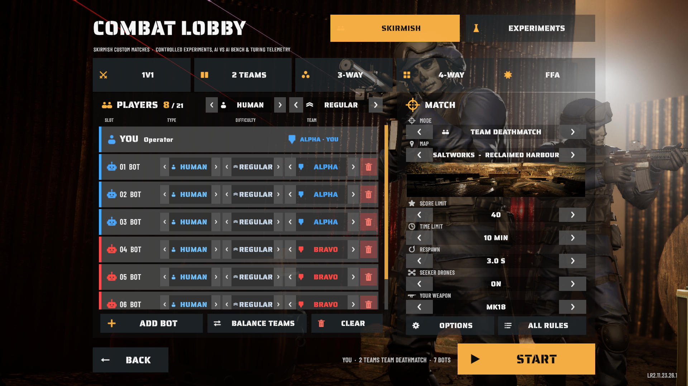
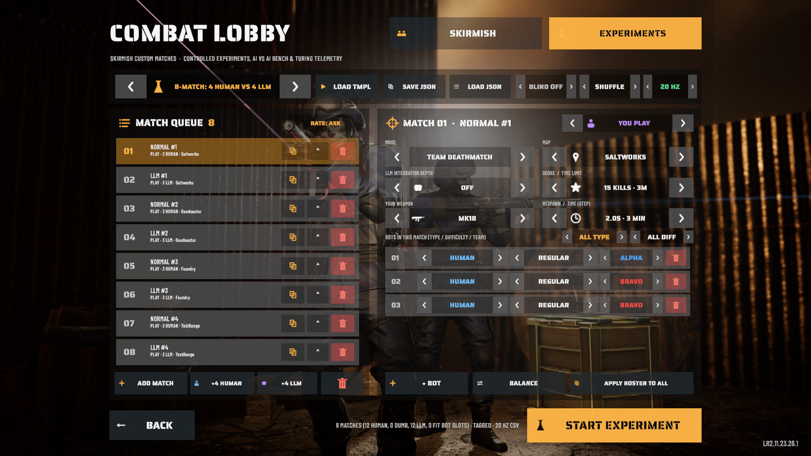
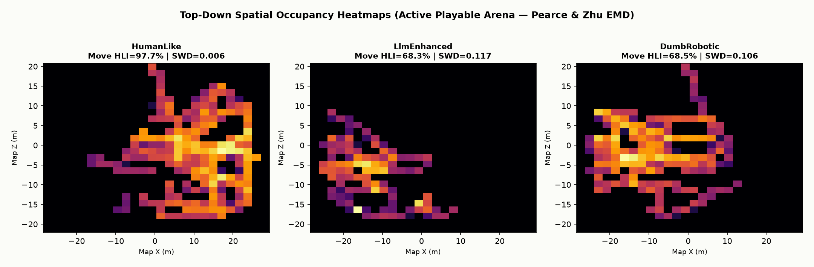
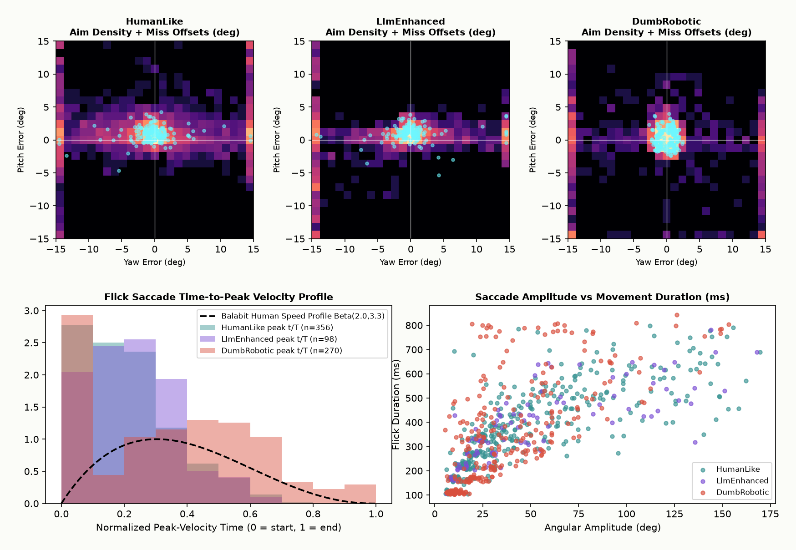
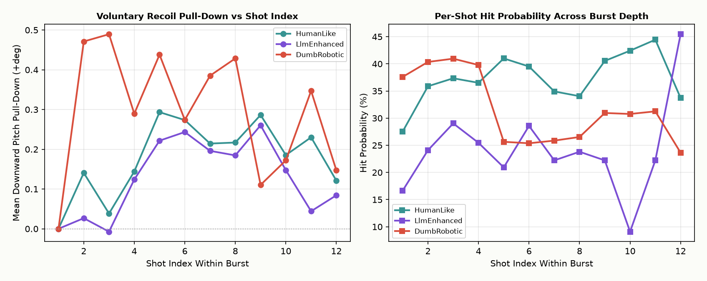
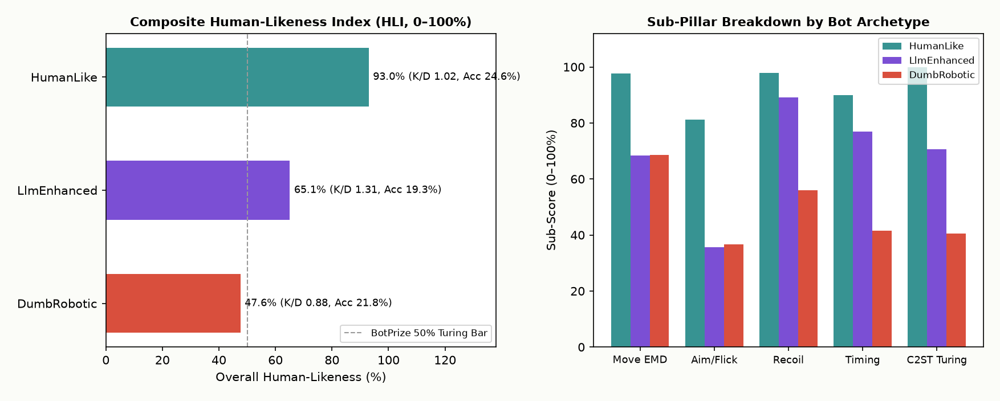

# Lead Rush II — Empirical Human-Likeness Evaluation, Heatmaps & Data-Driven Bot Fitting (`11.24.26.1`)

**Ultimate Project Goal:** Build autonomous FPS opponents that are **indistinguishable from real human players** in movement, aiming kinematics, miss geometry, recoil compensation, combat timing, and tactical adaptation — validated mathematically using telemetry heatmaps, two-sample classifiers, and blinded human Turing tests rather than just K/D parity.

- **Lobby Dual-Tab System:** [`SkirmishLobby.cs`](../../Assets/LR2/Runtime/UI/SkirmishLobby.cs) & [`ExperimentsTabView.cs`](../../Assets/LR2/Runtime/UI/ExperimentsTabView.cs)
- **Telemetry Schema & `Data/` Layout:** [`DATA_COLUMNS.md`](DATA_COLUMNS.md)
- **Offline Analyzer & Curve Fitter:** [`Tools/analyze_experiment_session.py`](../../Tools/analyze_experiment_session.py)
- **Data-Driven Bot Profile Loader:** [`HumanBehaviorProfile.cs`](../../Assets/LR2/Runtime/AI/HumanBehaviorProfile.cs)
- **Interactive Visualization Lab (Maneuvers + Heatmaps):** [`Docs/Bot/llm-architecture.html`](../Bot/llm-architecture.html)

---

## 1. Dual-Tab Combat Lobby & Experimental Session Designer (`B153`)

The Combat Lobby separates casual matches from controlled experiments:
- **`SKIRMISH` Tab:** Quick 2-Team, 4-Way, Duel, and FFA matches with customizable bot slots (`TYPE`: `HUMAN` / `DUMB` / `LLM` / `FITTED`, `DIFF`: `RECRUIT`–`ADAPTIVE`, `TEAM`) — **no spectator toggle** (moved out to Experiments).
- **`EXPERIMENTS` Tab (incl. `AI VS AI` Spectator Mode):** Build customizable **N-match experimental queues** (e.g., an 8-match `4 Human-Like vs. 4 LLM` block, a `6-match 1v1 Blind Turing Test`, or `4-match AI vs AI Bench`), toggle **Blind Mode** (hiding bot archetypes/difficulty labels in scoreboard & HUD), **Randomize Match Order**, set **`20 / 30 / 60 Hz` telemetry sampling**, save/load shareable JSON presets in `Data/Presets/`, and record post-match **0–100% Human-Likeness Turing ratings** (`Ratings_*.csv`).

| `SKIRMISH` Tab (Casual Play + Type Steppers) | `EXPERIMENTS` Tab (N-Match Session Designer + `AI VS AI`) |
|---|---|
|  |  |

---

## 2. Literature Grounding & Four Competing Bot Archetypes (`B152`, `B154`, `B157`)

Simply matching **K/D ratio (`~1.0`) and shot accuracy (`~22%`)** does **not** produce human-like bots: a mechanical bot with fixed reaction lag and constant angular slew can achieve identical scoreboard stats while instantly feeling fake. Guided by five primary benchmarks — **2K BotPrize / $\text{UT}^2$** (Hingston 2009; Schrum et al. 2012), **Pearce & Zhu (2022) CS:GO Spatial EMD Heatmaps**, **Devlin et al. (2021) Microsoft Navigation Turing Test**, **Balabit / ESTA / CSKnow / Aim Lab mouse dynamics**, and **Lopez-Paz & Oquab (2017) C2ST** — Lead Rush II compares four distinct archetypes:

| Archetype | Motor & Aim Model | Movement & Tactical Model | Experimental Purpose |
|---|---|---|---|
| **`HumanLike`** | Fitts's Law (`0.065 + 0.042·ID`) + Balabit `Beta(2.0, 3.3)` flicks, wrist bow, `125 ms` velocity lag, `1.55:1` Perlin tremor, `65–135 ms` recoil reaction delay | ADAD reversals, crouch/jiggle peeks, slide breaks, cover retreat on reload, flank/resupply | Procedural literature-grounded baseline |
| **`DumbRobotic`** (`B154`) | Linear constant-speed angular slew (`145–260 °/s`, no Fitts/Beta curve), fixed reaction delay (`0.24–0.50 s`), isotropic error cone (`1.95–3.45°`), zero recoil pull-down delay | Direct NavMesh pursuit, stops dead in combat (`0%` crouch, `0%` sprint, no corner slice/peek) | **Skill-matched robotic control** proving HLI catches mechanical bots even at ~1:1 K/D |
| **`LlmEnhanced`** | Inherits active team/solo System 1 kinematics (now supported in **1v1 Duel & FFA**, not just 4v4 squads) | Groq Cloud async planning (`Commander`, `TacticalMicro`, `AvatarPilot` action chunks) | Evaluates macro strategy vs. latency & human movement |
| **`HumanFitted`** (`B157`) | Loads fitted participant constants from `Data/Profiles/human_behavior_fit.json` (`fittsA/B`, `betaA/B`, `reactMu/Sigma`, `recoilCompGain`) | Uses fitted `strafeSwitchHz`, `crouchDuty`, `burstMean`, scaled `0.72× / 0.90× / 1.00× / 1.15×` by tier | Target **data-driven "plays like me" clone** trained on user CSVs |

---

## 3. Composite Human-Likeness Index (`HLI`, 0–100%)

[`Tools/analyze_experiment_session.py`](../../Tools/analyze_experiment_session.py) evaluates any candidate bot distribution $Q$ against a reference class $P$ (`Human` player telemetry when present; split-half `HumanLike` during headless calibration) using five pillars:

$$\text{HLI}(Q \parallel P) = 0.20\,S_{\text{move}} + 0.25\,S_{\text{aim}} + 0.15\,S_{\text{recoil}} + 0.15\,S_{\text{timing}} + 0.25\,S_{\text{C2ST}}$$

- **$S_{\text{move}}$ (`20%`):** 2D spatial occupancy **Sliced Wasserstein Distance (36 projections)** over active arena $(X, Z)$ coordinates + locomotion speed histogram **Jensen–Shannon Divergence (JSD)**.
- **$S_{\text{aim}}$ (`25%`):** 2D target-relative crosshair error `(err_yaw_deg, err_pitch_deg)` Sliced Wasserstein Distance + flick `time_to_peak_frac` Wasserstein alignment + angular error spread parity.
- **$S_{\text{recoil}}$ (`15%`):** Mean voluntary downward compensation (`raw_pulldown_pitch`) parity across burst shots + shot-per-burst depth distribution JSD.
- **$S_{\text{timing}}$ (`15%`):** First-shot visuomotor reaction time Wasserstein-1 distance (`TARGET_ACQUIRED -> FIRST_SHOT_ON_TARGET`) + combat ADS and crouch duty differences.
- **$S_{\text{C2ST}}$ (`25%`):** **5-fold stratified L2-regularized Logistic Regression Classifier Two-Sample Test** trained over non-overlapping `2.0 s` windows (`mean_speed, strafe_flip_hz, crouch_duty, mean_ang_vel, p95_ang_vel, ang_jerk, aim_err_std, ads_duty, fire_duty, dist_to_cover`), mapped via $100 \cdot \max(0, 1 - 2\max(0, \text{AUC}_{\text{CV}} - 0.5))$. A classifier stuck at chance (`AUC = 0.50`) yields **`100%` indistinguishable**.

---

## 4. Empirical Calibration & 20 Hz Heatmap Study (`cal_session`, C1–C3)

Before running player-vs-bot experiments, we tuned and verified the three active archetypes in `Lead Rush II.exe` (`-lr2AimBench -lr2BenchSeconds 75` on `LR2_Saltworks` at **20 Hz**, logging `32,280` ticks, `724` flicks, and per-shot recoil bursts across 3 calibration matches):

### A. Match Scoreboards & `InvasionFramerate`-Style Frame Delivery Audit

| Run | Matchup (`75 s`, `LR2_Saltworks`) | Alpha Score & Acc | Bravo Score & Acc | Logged Frames | Avg / p95 / p99 Frame Time | Slow Frames (`> 33 ms`) |
|---|---|---:|---:|---:|---:|---:|
| **`C1_DumbReg`** | Alpha `DumbRobotic` Reg vs Bravo `HumanLike` Reg | `20K / 25D` (`0.80` K/D, `21.8%` acc, `0%` crouch, `0%` sprint) | `25K / 20D` (`1.25` K/D, `29.9%` acc) | `6,414` | `11.70 / 14.09 / 17.69 ms` | `18` (`0.28%`) |
| **`C2_DumbVet`** | Alpha `DumbRobotic` Vet vs Bravo `HumanLike` Vet | `24K / 25D` (`0.96` K/D, `21.8%` acc, `0%` crouch, `0%` sprint) | `25K / 24D` (`1.04` K/D, `28.1%` acc) | `6,378` | `11.76 / 14.00 / 18.83 ms` | `18` (`0.28%`) |
| **`C3_LlmReg`** | Alpha `LlmEnhanced` Commander Reg (live Groq `gpt-oss-20b`) vs Bravo `HumanLike` Reg | **`21K / 16D`** (`1.31` K/D, `19.27%` acc, `15.79%` HS; `3/8` Groq OK, `11` orders, `0` rej.) | `16K / 21D` (`0.76` K/D, `16.8%` acc) | `6,822` | `11.00 / 13.17 / 17.75 ms` | `17` (`0.25%`) |

> **Zero Mid-Match Disk Stutter Confirmed:** Across `19,614` rendered gameplay frames, average frame time held at **`11.00–11.76 ms` (`~85–91 FPS`)**, `p99 <= 18.83 ms`, and CSV serialization ran exclusively off-thread behind the post-match overlay.

### B. Measured HLI & Behavioral Profiles (`cal_session`)

| Archetype | Actors | Ticks (`20 Hz`) | K/D | Acc % | HS % | Speed (`m/s`) | Strafe Flips / Actor | ADS / Crouch / Sprint | Near Cover (`<=2.5 m`) | **Overall HLI** | `Move` | `Aim` | `Recoil` | `Timing` | `C2ST` (`AUC`) |
|---|---:|---:|---:|---:|---:|---:|---:|---:|---:|---:|---:|---:|---:|---:|---:|
| **`HumanLike`** | 12 | 16,140 | 1.02 | 24.6% | 13.4% | 2.15 | 26.6 | 44.6% / 1.7% / 8.6% | 69.8% | **`93.0%`** | 97.7% | 81.1% | 97.8% | 90.0% | 100.0% (`0.402`) |
| **`LlmEnhanced`** | 4 | 5,420 | **1.31** | 19.3% | **15.8%** | 1.49 | 19.5 | 41.1% / 1.8% / 6.0% | **73.0%** | **`65.1%`** | 68.3% | 35.6% | 89.2% | 76.9% | 70.6% (`0.647`) |
| **`DumbRobotic`** | 8 | 10,720 | 0.88 | 21.8% | 5.0% | **2.57** | 13.6 | 21.2% / **0.0%** / **0.0%** | 61.1% | **`47.6%`** *(Fails 50% Turing bar)* | 68.5% | 36.6% | 55.9% | 41.6% | 40.6% (`0.797`) |

**Key Diagnostic Insights From the Measured Heatmaps:**
1. **`DumbRobotic` Hits K/D Parity (`24–25`) Yet Fails the Turing Bar (`47.6%` HLI, `C2ST AUC 0.797`):** Even after matching Regular/Veteran kill-death counts, `DumbRobotic` exposes its robotic signature immediately: `0.0%` crouch, `0.0%` sprint, half as many strafe reversals (`13.6` vs `26.6`), tight isotropic bullet clustering (`1.87°` miss spread vs `3.78–3.89°`), no Fitts/Beta saccade skew, and flat timing.
2. **`LlmEnhanced` Trades Movement Tempo for Objective Positioning (`65.1%` HLI, `1.31` K/D):** `LlmEnhanced` held cover more persistently (`73.0%` near cover vs `69.8%`), slowed average rotation speed (`1.49 m/s` vs `2.15 m/s`) while anchoring flanked angles (`'Flank E2 with A1, attack with A3, retreat A4'`), and out-fragged equally aimed `HumanLike` opponents **`21–16`** while raising headshot conversion (`15.8%`).

### C. Generated 20 Hz Visual Heatmaps (`Docs/Media/experiments/`)









---

## 5. How to Run Your Own Human-vs-Bot Experiment & Fit `"HumanFitted"` Clones

1. **Launch `Lead Rush II` -> `PLAY` -> `EXPERIMENTS` Tab:**
   - Choose **`8-MATCH: 4 HUMAN vs 4 LLM`** (or **`6-MATCH: 1V1 TURING BLIND`**) or customize every match slot freely (mode, map, bot types, tiers, LLM depth, `20/30/60 Hz`).
   - Enable **BLIND** and **RATE** if you want subjective `0–100%` believability scores without seeing which archetype spawned.
2. **Play Through the Session:**
   - At the end of every match, the full-screen `SAVING EXPERIMENT TELEMETRY` overlay writes CSV/JSON files off-thread into `<exe dir>/Data/Logs/<sessionId>_<runId>/` (`<project>/Data/Logs/` in Editor).
3. **Mine Data, Render Personal Heatmaps & Fit Your Equations:**
   ```powershell
   python Tools/analyze_experiment_session.py `
     --session "Data/Logs/1_Ab21" `
     --out "Data/Logs/1_Ab21/analysis" `
     --reference Human
   ```
   Copy (or point) the fitted parameter vector into `Data/Profiles/human_behavior_fit.json`:
   ```powershell
   Copy-Item "Data/Logs/1_Ab21/analysis/human_behavior_fit.json" "Data/Profiles/human_behavior_fit.json" -Force
   ```
   *(Current `cal_session` baseline fit already generated in `Logs/LR2_Experiments/cal_session/analysis/human_behavior_fit.json`: `fittsA=0.065`, `fittsB=0.042`, `betaA=1.4`, `betaB=4.349`, `reactMu=-0.783`, `recoilLagSec=0.095`, `recoilCompGain=0.594`, `strafeSwitchHz=1.537`, `burstMean=6.77`.)*
4. **Spawn `FITTED` (`HumanFitted`) Opponents:**
   - Select **`FITTED`** in any Skirmish or Experiment slot. `HumanBehaviorProfileLoader` automatically loads `Data/Profiles/human_behavior_fit.json` and scales your personal timers across `Recruit` (`0.72×`), `Regular` (`0.90×`), `Hardened` (`1.00×`), and `Veteran` (`1.15×`).
