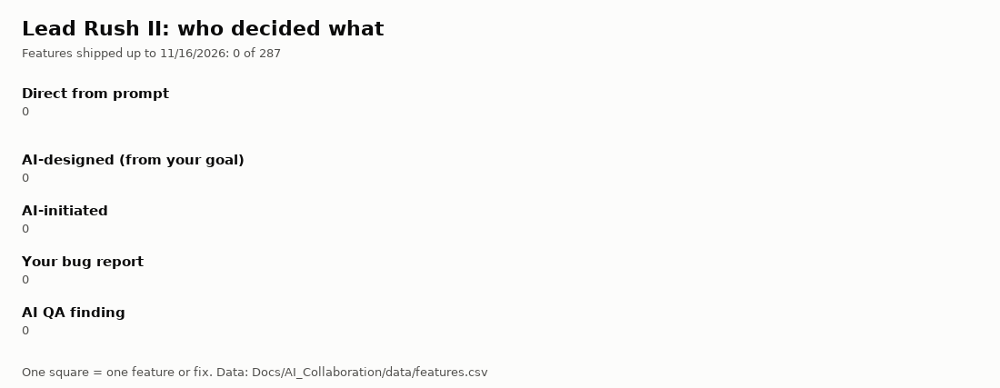

# Lead Rush II - what's new on 2026-11-20 (player build of 11-20 10:13, and the docs pushed after it)

Everything below was built by Claude Code (`claude-opus-5-5`) from the developer's reports of 11-19 and 11-20. Copilot was retired
on 11-19 and its open rows moved to Claude. Every item has a tracker row on [`AGENT_COORDINATION.md`](../../AGENT_COORDINATION.md) and a
ledger row in [`Docs/AI_Collaboration/data`](../AI_Collaboration/data).

## Weapon flips fixed at the root (B125)

The developer's report (11-19 14:27): *"the weapon keeps on going up then roating fully. that is a primary fix. happens to all the weapons"*.

The fix took four separate causes. Claude built instruments first, then fixed each cause only after a measurement confirmed it:

- a per-frame flip detector;
- a 40-frame "black box" recorder;
- switches that turn single animation layers off.

| Cause | Fix |
|---|---|
| Kinemation evaluates the stop, crouch, lean, jump and equip motion curves inside parallel animation jobs. Every soldier shared the same curve assets, and Unity's `AnimationCurve` is not thread-safe, so a soldier now and then read a garbage angle for one frame. | Each soldier gets its own copy of every motion |
| Hit flinches bent the hidden animation rig *after* its pose had been copied to the visible body | The flinch now bends the visible body |
| Kinemation's wall tuck (the gun pulls back near walls) ran at full strength while aiming down sights, swinging the rifle across the sights | The tuck is scaled by the aiming weight, with a 12 % floor |
| The game's own after-animation gun edits fed back into the next frame | The gun pose is reset before Kinemation runs each frame |

| Measure | Before | After |
|---|---|---|
| Rifle swing aiming into a wall, head-on | 22.8° | 3.4° |
| Dying against a wall while aiming | 22.9° | 3.6° |
| Aiming at 45° into a wall | 10.5° | 1.9° |
| Bots: single-frame spikes in two matches | 7 and 23 | 0 and 0 |
| Bots: largest gun swing in two matches | 179° and 177° | 64° and 67° |
| Bots hit while aiming: frames over 60° | 286 | 28 |

The first fix, an after-animation clamp called the flip guard, is now off by default; `-lr2FlipGuard` turns it back on. The new test
switches are listed in [TOOLING.md](../TOOLING.md#weapon-stability-and-llm-switches-b125-b127). The full walkthrough of the IK
pipeline is in the [weapon IK report](../Animation/weapon-ik-report.html).

## Drone explosion sound (B126)

Seeker drones now explode with a real blast. Before, they played only falling concrete.

- **The blast:** six C4 explosion recordings from the developer's private sound library. The variations keep repeats from sounding identical.
- **The debris** follows 50 ms later.
- **The reach** is 90 m.
- **Kept private:** the clips stay in the git-ignored audio folder.

## LLM squad commander (B127, waiting for an API key)

A bot team can now take orders from a large language model on Groq's free tier, so it can be compared with the rule-based bots.

- **What the commander sees:** only what its team knows, such as the last place each enemy was seen.
- **How often it acts:** it sends an order every 12 s.
- **How the orders run:** they become directives for the existing bots, and each one is posted to the squad chat.
- **How it is measured:** the AI vs AI bench writes per-team K/D for the comparison.

**To try it,** launch with `-lr2LlmTeams Alpha` and give the key through any of these:

- `GROQ_API_KEY`;
- `-lr2GroqKeyFile <path>`;
- `groq_api_key.txt` in the game's persistent data folder.

The key is never logged or committed. The experiment runs once the developer adds a key.

## Bot Lab v13 (B128)

The [Bot Lab](../Bot/bot-lab.html) has three new parts:

- **How the body holds the gun.**
- **A clickable damage-model figure** with head, torso and legs.
- **A full spec table for the five guns**, with presets measured in the game.

It also has the audit fixes. Everything on the page is mirrored for Gemini in
[`ARTIFACTS.md`](../AI_Collaboration/ARTIFACTS.md).

## Who decided what (B129)

A new research page, [**Who decided what**](../AI_Collaboration/DECISION_PROVENANCE.md), traces all 270 features and fixes to where
the decision came from:

- **31 %** straight from a prompt;
- **30 %** AI-designed from the developer's goal;
- **13 %** AI-initiated;
- **21 %** from the developer's bug reports;
- **5 %** from AI QA findings.

The page also has nine case studies and an evaluation using the methods of published human-AI studies. The
[**atomic feature table**](../AI_Collaboration/FEATURES_TABLE.md) lists every feature with the developer's words, the AI's decisions,
the agent, the model and the outcome.

## Main menu: tiles, a callsign and a b-roll camera (B130, B131)

The developer asked for three changes to the title screen:

- *"remove the map selection thing from main menu thats not needed anymore, maybe place the avatar there and keep moving the cam
  in a cinematic way? like show then gun then cut, show the face from left to right then show another angle, like broll?"*
- *"in the main menu the black bg tint may not be needed"*
- *"make the play settings etc buttons a biot cooler? maybe tiles?"*

| Before | Now |
|---|---|
| A "map recon" card on the right, a dark band on the left, plain PLAY / SETTINGS / QUIT bars | The card and the band are gone. PLAY, SETTINGS and QUIT are tiles, each with an icon, a title and a line on what is inside; they react on hover. |
| One slow wide shot and an orbit | A loop of six hard-cut shots, each drifting on its own, with your soldier framed on the right where the card was: a wide, a push along the gun, a pan across the mask, a low angle, the profile, and a tilt from the hands to the mask. |
| The player was always "Operator" | A **CALLSIGN** field at the top right. The name you type is used for your soldier in every match: kill feed, scoreboard, chat, killcam and the lobby roster. |

The lobby's left and right buttons now draw chevron icons. The old "<" and ">" characters did not exist in the lobby's heading font,
so the buttons showed up empty.

| The title loop | The lobby |
|---|---|
|  |  |

## Killcam replay: only the killer's bullets (B132)

The developer's report: *"while showing the replay, the bots bullets are going totally in the wrong direction."*

**What was wrong.** The killcam recorded every shot fired by anyone in the last few seconds. It then replayed all of them as tracers
from the killer's gun. With several bots in a match, every other bot's rounds, and the victim's own, came out of the killer's muzzle
pointing wherever their shooters were aiming.

**The fix.** The replay now draws only the killer's shots, the same filter the replayed hits already used.

## Bot Lab: where the bot aims, and pull-down plots (B133)

The developer asked: *"where is the bot trying to aim? show that first, also show some plots for pulldowns."*

The [Bot Lab](../Bot/bot-lab.html)'s recoil section now:

- **Shows the aim point first.** A crosshair on the centre of the chest appears before each spray starts.
- **Lands the first round on the crosshair.** The round leaves the barrel before its own kick.
- **Adds two plots:**
  - the height of every round above the aim point, by round, for each skill level and for nobody pulling down;
  - one kick and the pull back over time, with a dot where each skill level starts pulling.
- **Reads out every round on hover.** Hovering the first plot shows each bot's value for that round.

