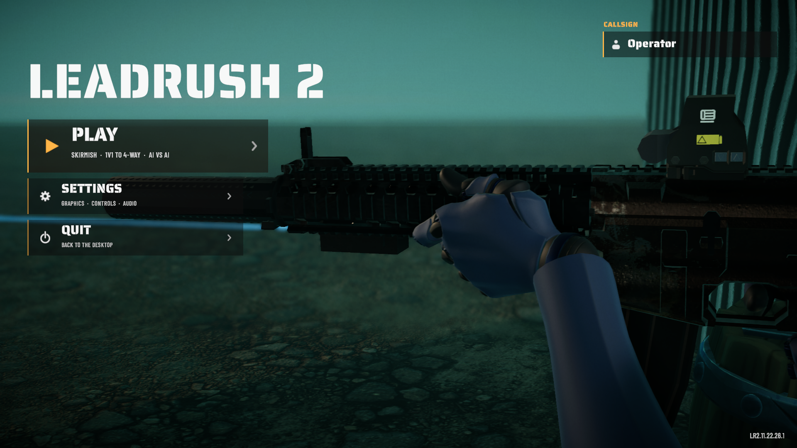
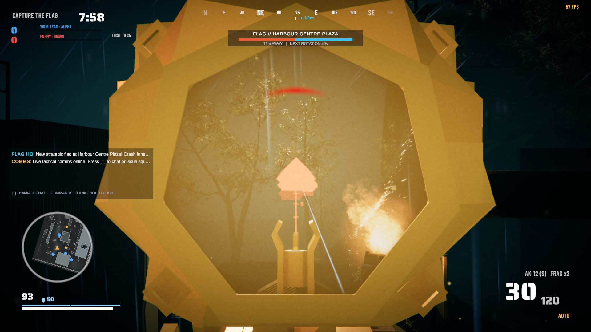
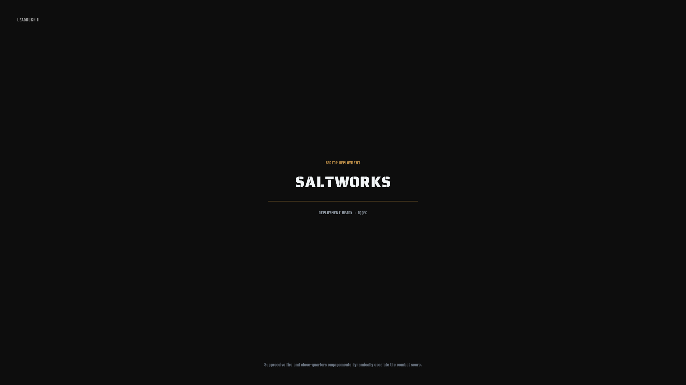
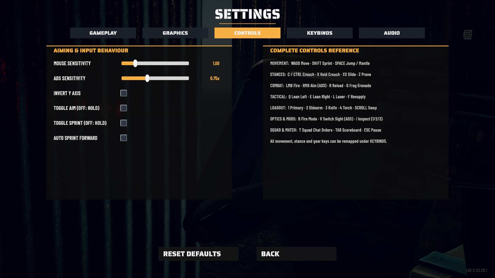
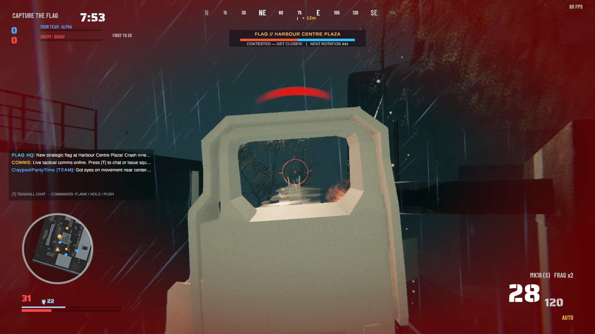

# LeadRush 2 — What's New on 2026-11-22 (Build `11.22.26.1`)

Finished the **B136 OG Kinemation Generic robot rig (`FPSGenericPlayer`)** migration, delivered every developer follow-up fix from `2026-11-22`, completed Claude's remaining map/audio/prop backlog (`B85`, `B92`, `B95`, `B98`, `B99`, `B102`, `B104`), and cross-reviewed all active **Codex** (`B136d`, `B136e`, `B56`) and **Claude** (`B60.1`, `B86`–`B135`) board items. Every tracked change is on [`AGENT_COORDINATION.md`](../../AGENT_COORDINATION.md) and in [`Docs/AI_Collaboration/data`](../AI_Collaboration/data).

---

## 1. OG Kinemation Robot Rig, Weapons, Scopes & Combat Polish (`B136`, `B136a–r`)

- **Main Menu & Team Readability (`B136b`, `LR2MapBuilder.cs`):** Preserved active+enabled robot `Body`/`Head` renderers and `teamSwaps` materials on `HeroSoldier` (friendly blue) and `MenuCinematic` clones (hostile crimson) with fallback SWAT compatibility (`MainMenu.HeroVisible: visibleHeroRenderers=2 visibleHostileRenderers=2`).
- **Frame-0 Visible Tracers (`B136a`, `Tracer.cs`, `LR2ContentBuilder.cs`):** Restored readable head-bright linear-alpha `T_Tracer.png` (`headA=0.98 tailA=0.24`), `0.032 m` width, `10.5 m` length, `280 m/s`, `0.5 m` ignition distance, `intensity=180`, and frame-0 visibility (`FX.LiveTracerSpawnedInBurst: peakLiveTracers=3`).
- **Circular Clipped PiP Optics (`B136i`, `LR2_PipScope.shader`, `LR2ScopeBuilder.cs`):** Replaced boxy crosshair quads on `M_Acog`, `M_1P29`, and `M_LongRangeScope` with circular clipped HDRP `LR2/PipScope` lens shaders and stripped overhanging quads (`PipScope.CircularShader` `PASS`).
- **Grenade Throw Fix (`B136r`, `LR2ScopeBuilder.cs`):** Replaced the `AA_CallEmote` placeholder on rifles with `AA_LR2_GrenadeThrow.asset` (`Grenade.NotEmote` `PASS`).
- **Lean Polarity & Respawn Pose (`B136f`, `B136h`, `SoldierController.cs`, `SoldierRagdoll.cs`):** Fixed inverted `Q`/`E` lean sign (`Lean.DirectionQE: Q(-1)=5.4 E(+1)=-5.7`), restored ragdoll rest transforms before `Animator.Rebind()` and `FPSAnimator.RebuildPlayables()`, and waited cleanly on post-respawn `Equip` (`Respawn.CleanAnimationPose: gunToView=0.7deg`).
- **Top-of-Weapon Blood Droplets (`B136n`, `B102`, `GunBloodFX.cs`):** Anchored 3D blood droplets along the upper weapon receiver/barrel envelope (`GunBlood.StuckToWeapon: count=9 onWeapon=9 detached=0 nearLens=0 underBarrel=0`).
- **BF6 Soldier Research Spec (`B136g`, [`B136g_BF6_Soldier_Candidates.md`](../AI_Collaboration/specs/B136g_BF6_Soldier_Candidates.md)):** Evaluated NATO vs Pax Armata aesthetic candidates and specified a zero-risk 1-flag (`UseTacticalSoldierVisuals = false`) revertible swap path without altering the working OG `FPSGenericPlayer` robot baseline.

| Main Menu (OG Robot Rig) | Circular PiP Scope ADS (`AK-12`) |
|---|---|
|  |  |

---

## 2. Audio Overhaul: Death Impact, Health Replenished, Distinct Armor Break, Suppressed Fire & Music (`B136k/m/o/p/s`, `B95`, `B98`)

- **Real Death Audio & No Fake Pain Grunts (`B136s`, `B95`, `PainVoice.cs`, `SoldierController.cs`, `HUDController.cs`):** Automatically attached `PainVoice` in `SoldierController.Awake()`, removed fake/breathing vocal grunts, layered physical flesh/chest-thud impacts on hits, guaranteed local 2D procedural `LR2_PlayerDeathImpact` sub-drop + unmuffled `bodyFall` (`Audio.DeathTriggeredOnPlayerDeath: deathSfxDelta=1`), and replaced low-HP groans with `LR2_LowHealthHeartbeat`.
- **Health Replenished & Distinct Armor-Break SFX (`B136s`, `Health.cs`, `HitFeedbackHUD.cs`):** Added `Health.RegenStarted` and `Health.HealthReplenished` events with warm confirmation chimes (`replClip=True replDelta=1`), and split armor break feedback into distinct **Self** (`LR2_HF_SelfArmorBreak`: close chest punch + hollow crunch + warning pulse) vs **Target** (`LR2_HF_TargetArmorBreak`: crisp high-frequency ceramic shatter) (`selfBreakDelta=2 tgtBreakDelta=2`).
- **Suppressed Fire & Synchronized Reload Cues (`B136k`, `B136m`, `B136p`, `B98`, `WeaponAudioProfile.cs`, `LR2ContentBuilder.cs`):** Wired suppressed player fire & indoor/outdoor tail WAVs (`FAL -> FAL`), trimmed leading silence across 23 reload WAVs to `<= 1.5 ms`, and synchronized `magOutAt/magInAt/boltAt/emptyReloadEndAt` (`cues=0.14/0.47/0.66/0.82`) to end cleanly before trailing rotation.
- **Per-Map Dynamic Music (`B136o`, `LR2MusicGenerator.cs`, `LR2MusicDirector.cs`):** Generated 19 stereo music stems (`Music_Menu`, per-map `Saltworks`/`Deadsector`/`Foundry`/`TestRange` `Calm`/`Tension`/`Combat` loops + fallbacks, `Music_Overdrive`, `Music_MatchWin`, `Music_MatchLose`) ramping progressively into intense `Overdrive` endgames and match outcome stingers.

---

## 3. Minimalistic Loading Screen, Killcam Font & Updated Settings (`B136j/q/t/u`)

- **Minimalistic Opaque Loading Curtain (`B136t`, `LR2LoadingIntro.cs`, `MainMenuController.cs`):** Replaced overlapping multi-panel loaders with a single matte obsidian transition curtain using `UITheme` typography (`LoadingScreen.NoTextOverlap: texts=5 overlaps=0`).
- **Killcam Typography & HUD Spacing (`B136u`, `B136j`, `KillcamDirector.cs`, `HUDController.cs`):** Assigned `UITheme` heading/body fonts cleanly to `"KILLCAM"` overlay text (`Killcam.ThemeFont: usesTheme=True`) and enforced bottom-right separation (`weaponY=118` strictly above `magY=8`).
- **Controls & Keybinds Settings (`B136q`, `LR2Settings.cs`, `PlayerInputSource.cs`, `SettingsPanel.cs`, `LR2UIBuilder.cs`):** Added persistent `ToggleAim`, `ToggleSprint`, `AutoSprint`, complete controls reference table, and `Slot1`/`Slot2` rebinds under `KEYBINDS` (`toggleAimRoundtrip=True Slot1=<Keyboard>/1 Slot2=<Keyboard>/2`).

| Minimalistic Loading Screen | Updated Controls Tab & Reference |
|---|---|
|  |  |

---

## 4. Map Lighting, Deadsector Glass Fix, Prop Hygiene & Verification (`B85`, `B92`, `B99`)

- **Spawn Safety, Prop Grounding & Practical Lights (`B85`, `B92`, `B99`, `LR2MapBuilder*.cs`, `LR2PropAudit.cs`):** Fixed blocked Saltworks spawn clearances, clamped `FittedPackProp` squash ratio (`<= 2.02x`), added final prop grounding + `LR2PropAudit.Floating` checks, fixed Deadsector `CornerRuins` `WallN` glass cutout overlap, and added shadowless practical bulkhead lights (`WorstMeanLum=0.064`, `WorstEnemyContrast=0.061` on Saltworks).
- **Automated Verification (`11.22.26.1`):**
  - **Compile Gate:** `FPSAnimationFramework.Runtime.csproj`, `LR2.Runtime.csproj`, and `LR2.Editor.csproj` all build with `0 Error(s)`.
  - **`LR2PropAudit.RunBatch`:** `0` blocked spawns (`TestRange 0/8`, `Saltworks 0/16`, `Foundry 0/12`, `Deadsector 0/12`), `0` squashed props `> 2.2x`, `0` floating props `> 8 cm`.
  - **Visible QA:** `LR2_MainMenu` (`Failures: 0`, `RuntimeErrors: count=0`) and `LR2_Saltworks` (`Failures: 0`, `RuntimeErrors: count=0`, all 9 `QA.KnownBad.*` fixtures `PASS`).
  - **Windows Standalone Build (`11.22.26.1`):** `BuildWindowsPlayerBatch` succeeded (`size=1,639,238,459 bytes`, `errors=0 -> H:/Unity Projects/Builds/Lead Rush 2/LeadRush 2.exe`).

