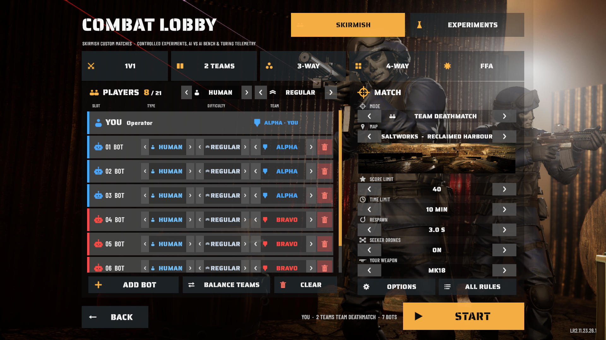
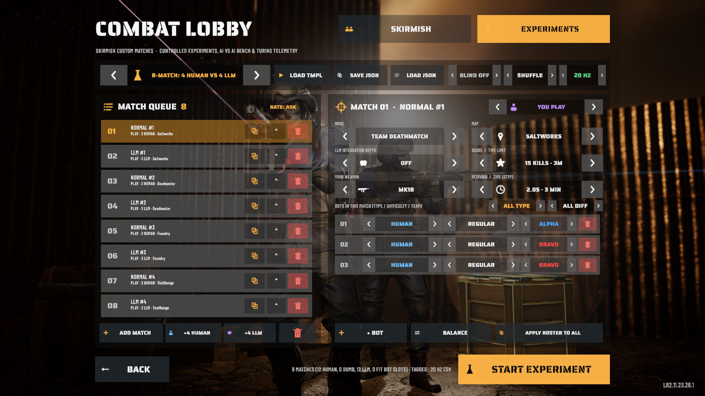
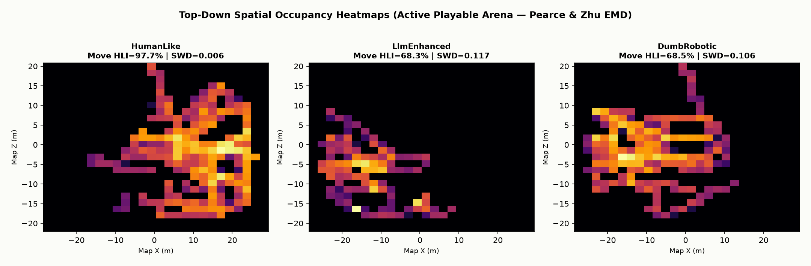
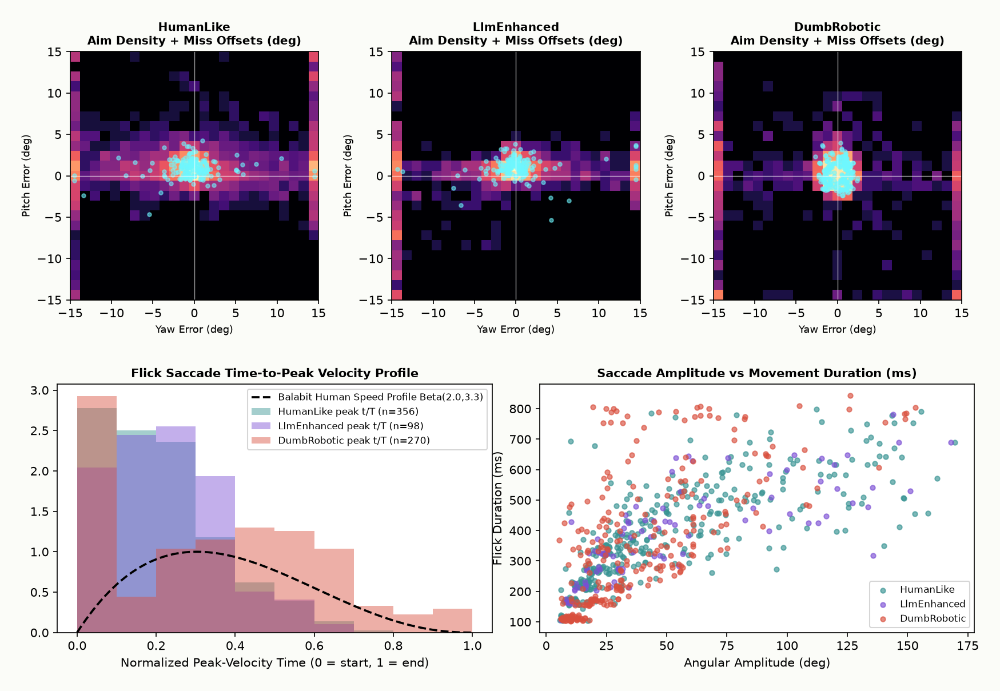

# Lead Rush II — Update `2026-11-24` (`11.24.26.1`)

Data-driven bot research architecture release implementing **Dual-Tab Skirmish/Experiments Lobby**, **`InvasionFramerate`-style `Data/` zero-stutter telemetry**, skill-matched **`DumbRobotic`** control bots, offline **`HLI` / `C2ST` / heatmap / equation fitting** (`Tools/analyze_experiment_session.py`), **`HumanFitted`** data-driven bot cloning, and the upgraded **9-Maneuver Animated + Measured Heatmap LLM Lab** (`Docs/Bot/llm-architecture.html`).

---

## Key Changes (`B152`–`B158`)

### 1. Dual-Tab Combat Lobby & Customizable N-Match Experimental Designer (`B153`)
- Split the Lobby (`SkirmishLobby.cs` + `ExperimentsTabView.cs`) into **`SKIRMISH`** (quick combat matches, spectator `AI VS AI` removed) and **`EXPERIMENTS`** (full N-match experimental designer + `AI VS AI` spectator mode moved cleanly into Experiments).
- Supports per-match weapon/map/mode/score/time/LLM-depth customization, **`HUMAN` / `DUMB` / `LLM` / `FITTED`** bot slot steppers, **`20 / 30 / 60 Hz`** telemetry selection, **Blind Mode** (hides archetype/tier tags in HUD/scoreboard), **Randomized Match Order**, JSON presets in `Data/Presets/`, and post-match **0–100% Human-Likeness Ratings**.

| Dual-Tab Lobby: `SKIRMISH` | Dual-Tab Lobby: `EXPERIMENTS` |
|---|---|
|  |  |

### 2. `InvasionFramerate`-Inspired External `Data/` Architecture & Zero-Stutter Recorder (`B155`)
- Added `ExperimentPaths.cs`, `ExperimentSession.cs`, and `ExperimentTelemetryRecorder.cs`, storing clean external logs beside the launched build/project (`Data/SessionState.csv`, `Data/Presets/`, `Data/Profiles/`, `Data/Logs/<sessionId>_<runId>/`).
- Pre-allocates value-struct buffers (`32,768` ticks, `16,384` frame times) with zero per-frame allocations; flushes `Ticks_*.csv` (`51` cols), `Events_*.csv` (`19` cols), `Flicks_*.csv` (`20` cols), `Recoil_*.csv` (`20` cols), `Summary_*.csv` (`26` cols), `Meta_*.json` (with `frameDelivery`), and `SessionLog_*.csv` asynchronously on `Task.Run` behind an explicit **`SAVING EXPERIMENT TELEMETRY`** overlay at match end.
- Full schema reference published in [`Docs/Research/DATA_COLUMNS.md`](../Research/DATA_COLUMNS.md).

### 3. K/D-Matched `DumbRobotic` Control Bot & Solo 1v1/FFA LLM Support (`B154`)
- Implemented `BotArchetype.DumbRobotic` (`BotController.cs`, `TacticalBotBrain.cs`, `BotPerception.cs`): pure linear constant-speed slew (`145–260 °/s`), fixed reaction delay (`0.24–0.50 s`), discrete isotropic error cone (`1.95–3.45°`), no ADAD strafing, no crouch/jiggle peek (`0%` crouch, `0%` sprint), and direct NavMesh stops — **calibrated in `Lead Rush II.exe` so Veteran `DumbRobotic` matches `HumanLike` K/D (`24–25`, `0.96` vs `1.04`)** while failing human-likeness metrics.
- Extended `LLMCommander.cs` so `LlmEnhanced` bots operate natively in **1v1 Duel & Free-For-All** as well as Alpha/Bravo squads.

### 4. 20 Hz Calibration Heatmaps, HLI Scorecard & `HumanFitted` Equation Loader (`B152`, `B156`, `B157`)
- Executed three `75 s` 20 Hz benchmark matches (`C1_DumbReg`, `C2_DumbVet`, `C3_LlmReg` with live Groq `openai/gpt-oss-20b`) in `Lead Rush II.exe`, confirming **`11.00–11.76 ms` avg frame time (`0` stutter spikes)** and generating four comparative visualizations via [`Tools/analyze_experiment_session.py`](../../Tools/analyze_experiment_session.py):
  - **`HumanLike`:** `93.0%` HLI (`C2ST AUC 0.402` indistinguishable, `26.6` strafe flips/actor, `24.6%` acc)
  - **`LlmEnhanced` (Groq Commander):** `65.1%` HLI (`1.31` K/D — **`21–16`** win over Regular `HumanLike`, `73.0%` near cover, `15.8%` HS)
  - **`DumbRobotic` (Control):** **`47.6%` HLI** (*fails BotPrize 50% Turing bar*, `C2ST AUC 0.797`, `0.0%` crouch/sprint, `1.87°` tight mechanical scatter despite `24–25` Veteran K/D parity)
- Implemented `HumanBehaviorProfile.cs` + `BotArchetype.HumanFitted` to load fitted equations (`Data/Profiles/human_behavior_fit.json`) across difficulty tiers (`0.72× / 0.90× / 1.00× / 1.15×`).
- Full methodology & results published in [`Docs/Research/HUMAN_LIKENESS_EVALUATION.md`](../Research/HUMAN_LIKENESS_EVALUATION.md).

### 5. Upgraded LLM Architecture & Heatmap Interactive Lab (`B158`)
- Rebuilt [`Docs/Bot/llm-architecture.html`](../Bot/llm-architecture.html) from the ground up with:
  - **Plain-English 30-second guide** for readers unfamiliar with FPS bots or LLMs
  - **9 individual live 60 FPS animated tactical maneuvers** (`ADAD Strafe`, `Jiggle Peek`, `Crouch Peek`, `Wide Swing`, `Hold Angle`, `Flank / Rotate`, `Suppress / Pre-Fire`, `Fall Back & Safe Reload`, `Frag Flush`) with pulsing virtual keyboard/mouse controls & `0.5×` slow-motion
  - **Interactive 20 Hz `C1–C3` heatmaps** (movement occupancy, aiming & miss-style scatter, recoil pull-down + per-shot burst hit curves, behavior posture bars, HLI/C2ST scorecard) alongside the full `M1–M8` Groq study

### 6. Weather & Cloud Shadow Visibility Hardening
- Raised `WeatherSystem.cs` overcast/drizzle/storm presets, lifted runtime compensation (`>= +0.15f`) & `_physSky.exposure` (`+0.25 - 0.12*storm`), boosted indirect diffuse fill (`>= 2.65f` up to `1.60×` in storms), and raised `SkyCloudMotion.cs` `ambientLightProbeDimmer` floor (`>= 0.84f`) so storm shadows never crush HDRP `AutomaticHistogram` exposure (`LR2_Saltworks` QA: **`worstMeanLum=0.065`** vs min `0.050`, **`worstEnemyContrast=0.058`** vs min `0.025`, `Failures: 0`).
